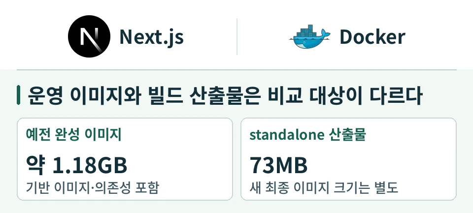

# Next.js 빌드에 필요했던 1GB가 운영 컨테이너에도 필요할까?

0plan 웹 앱의 예전 배포 이미지는 약 1.18GB였다. 의존성을 설치하고 사이트를 빌드하는 데 쓰인 `node_modules`가 약 1GB였고, 그 디렉터리를 통째로 실행 환경에 가져갔다. 의문은 단순했다. **빌드를 끝낸 서버가 사용자의 요청에 답할 때도 빌드 도구 전체를 읽는가?**

오른쪽의 73MB에는 **아직 실행용 기반 이미지가 없다**. 두 숫자만 나눠서 ‘이미지를 몇 퍼센트 줄였다’고 쓰면 빌드 도구가 실제로 줄인 양을 잘못 전하게 된다.

## 빌드할 방과 실행할 방

Docker 이미지를 두 단계로 나눴다. 첫 단계에서는 기존처럼 의존성을 설치하고 Next.js 빌드를 수행한다. 그때 `output: 'standalone'`을 쓰면 Next.js가 실행에 필요한 것으로 추적한 파일과 작은 `server.js`를 `.next/standalone`에 모아 준다. 두 번째 단계에서는 이 결과를 가져와 `node server.js`로 실행한다. 운영 컨테이너에서 프로젝트 패키지를 처음부터 다시 설치하지 않는다.

여기서 놓치기 쉬운 것이 그림과 스타일이다. `standalone` 폴더에 서버가 시작할 파일이 있다고 해서 `public`과 `.next/static`까지 자동으로 들어 있는 것은 아니다. 0plan처럼 이 서버에서 정적 파일도 제공한다면 **두 디렉터리를 실행 이미지에 따로 복사**해야 한다. 첫 HTML이 열린 뒤 로고나 브라우저용 자바스크립트를 못 받아 화면이 깨질 수 있는 지점이다.

## 73MB와 최종 이미지 크기를 혼동하지 않기

당시 로컬 검증에서 standalone 산출물은 **73MB**였고, 그 산출물로 서버를 시작해 HTTP `200`을 확인했다. 이것은 ‘최종 Docker 이미지가 73MB’라는 뜻은 아니다. 최종 이미지에는 Node 기반 이미지와 정적 자산 등도 들어간다. 변경 제안의 약 300MB는 **예상치**였다. 크기를 비교할 때는 산출물끼리, 또는 완성 이미지끼리 같은 단위를 맞춰야 한다.

같은 변경에서 빌드 캐시도 손봤지만 효과의 대상이 다르다. Bun 다운로드 캐시와 `.next/cache`를 빌드 단계에서 재사용하면 다음 빌드 때 다시 받을 것과 다시 계산할 것을 줄인다. 반대로 standalone은 **이미 빌드가 끝난 뒤 운영으로 운반할 것**을 줄인다. 캐시가 잘 맞아 빨리 끝난 빌드 하나만 보고 배포 이미지까지 작아졌다고 결론 내릴 수 없는 이유다.

*[그림 출처 및 이용 조건](https://raw.githubusercontent.com/0plan/blog/483cbd2a01d481c65a92f36ec805558f8858debf/assets/images/article-figures/credits.txt)*

## 다음에 읽으면 좋은 글

[직접 의존성 33개를 지우면서 애니메이션 패키지는 남긴 이유](%EC%A7%81%EC%A0%91%20%EC%9D%98%EC%A1%B4%EC%84%B1%2033%EA%B0%9C%EB%A5%BC%20%EC%A0%95%EB%A6%AC%ED%95%9C%20%EA%B8%B0%EC%A4%80.md) — 실행 이미지에서 빼는 일과 프로젝트에서 아예 지우는 일은 판단 기준이 다르다.
