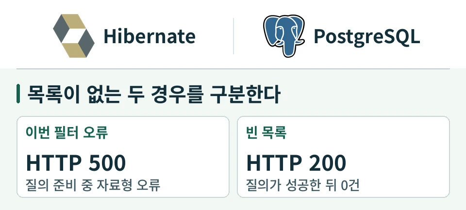
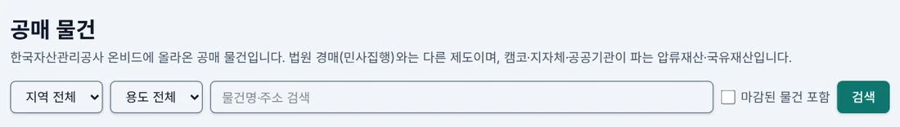

# 검색어를 넣지 않았을 뿐인데, 공매 첫 화면이 500이 됐다

공매 검색에서 가장 먼저 보게 되는 결과는 검색어를 입력한 결과가 아니다. **아직 아무것도 입력하지 않은 목록**이다. 8월 첫 배포 점검에서 바로 그 경로가 `500`을 반환했다. 데이터가 0건이라서가 아니라 PostgreSQL이 질의에 맞는 연산자를 정할 수 없어서였다.

## WHERE 조건을 건너뛰기 전에도 타입은 필요하다

목록 질의는 검색어가 없으면 그 조건을 적용하지 않고, 값이 있으면 이름이나 주소가 검색어를 포함하는지 `LIKE`로 비교하는 방식이었다. 사람이 보면 ‘검색어가 `null`이면 뒷부분은 볼 필요 없다’고 읽힌다. 하지만 DB가 질의를 준비할 때는 비교 대상의 자료형과 쓸 연산자를 정해야 한다.

운영 오류는 `character varying ~~ bytea`, SQLState `42883`이었다. 여기서 `~~`는 PostgreSQL이 오류에서 표시한 `LIKE` 연산자다. 왼쪽은 문자열인데 오른쪽은 바이너리 타입으로 전달됐다. 이 경로에서 Hibernate가 값 없는 문자열 파라미터의 타입을 정하지 못한 것이 문제였다. 검색어를 빈 문자열로 바꿔 보내는 화면 수정은 서버에서 받는 다른 선택 필터까지 해결하지 않는다.

## 검색 문자열을 사용하는 곳에서 자료형을 명시했다

그림은 **현재 공개 화면의 필터 부분**이다. 검색 칸에 아무것도 쓰지 않는 것이 정식 사용법인 이상, 그 요청도 검색어가 있는 경우와 마찬가지로 시험해야 한다.

질의에서 선택 문자열을 비교하거나 검색 패턴을 만들 때 `cast(:kw as string)`처럼 문자열임을 알려 줬다. 사용자가 검색어를 생략할 수 있다는 API의 약속은 바꾸지 않았다. 파서와 주소 변환 단위 테스트가 통과했어도 운영 PostgreSQL에서 이 조합으로 질의가 준비되는지는 별도 문제였다. 다음부터는 **필터 없는 기본 목록**, **검색어가 있는 목록**, **다른 필터만 있는 목록**을 실제 사용하는 DB 종류에서 구분해 볼 이유가 생겼다.

이후에 겪은 온비드 수집 권한 문제와도 증상이 다르다. 여기서는 DB 조회가 오류로 끝나서 목록 자체를 보여 줄 수 없었다. 나중 사례에서는 조회가 정상적으로 실행돼 **0건이라는 정당한 응답**을 만들었다. 사용자는 둘 다 ‘물건을 볼 수 없다’고 말할 수 있지만 운영자가 먼저 볼 곳은 다르다.

*[그림 출처 및 이용 조건](https://raw.githubusercontent.com/0plan/blog/483cbd2a01d481c65a92f36ec805558f8858debf/assets/images/article-figures/credits.txt)*

## 다음에 읽으면 좋은 글

[공매 페이지는 200인데, 물건은 왜 0건이었을까?](%EA%B3%B5%EB%A7%A4%20%ED%8E%98%EC%9D%B4%EC%A7%80%EB%8A%94%20200%EC%9D%B8%EB%8D%B0%20%EB%AC%BC%EA%B1%B4%EC%9D%80%200%EA%B1%B4%EC%9D%B8%20%EC%9D%B4%EC%9C%A0.md) — 같은 목록의 후속 사례다. 이번에는 질의보다 앞 단계인 수집 결과가 문제였다.
