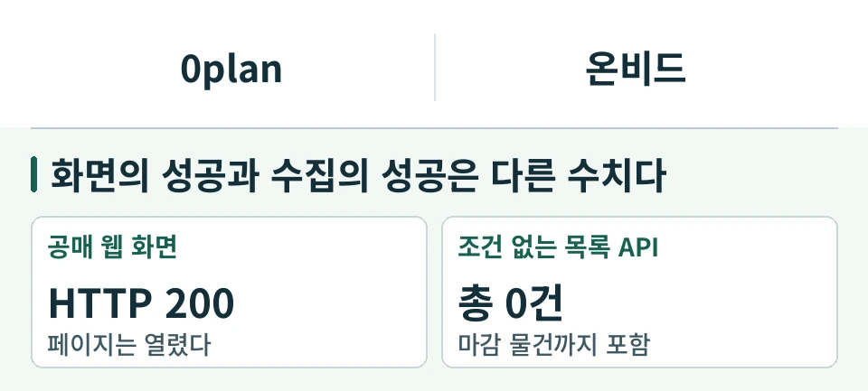
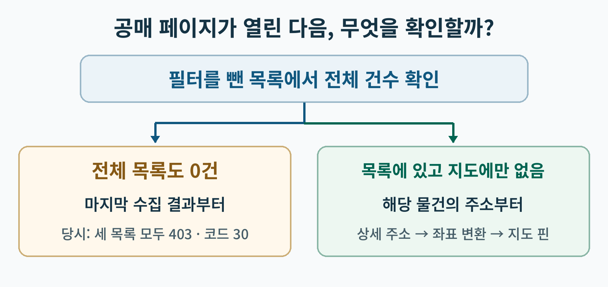

# 공매 페이지는 200인데, 물건은 왜 0건이었을까?

0plan의 공매 화면은 검색 결과가 없어도 정상 페이지를 보여 준다. 조건에 맞는 물건이 없는 것도 유효한 검색 결과이기 때문이다. 문제는 **수집이 실패해 물건이 한 건도 없어도 바깥에서는 똑같이 HTTP `200`이 보인다**는 점이다.

2026년 11월 25일 운영 점검에서 확인한 것도 이 경우였다. ‘사이트가 응답하는가?’라는 질문에는 이미 답이 있었다. 다음으로 물어야 할 것은 **‘수집된 물건이 있고, 그중 무엇을 화면이 보여 주고 있는가?’**였다.



그날 확인한 0은 [공매 화면의 지역·용도 필터](https://raw.githubusercontent.com/0plan/blog/483cbd2a01d481c65a92f36ec805558f8858debf/assets/images/article-figures/auction-filters.webp)를 좁혀서 나온 숫자가 아니다. **검색 조건을 모두 걷어 낸 뒤에도 남은 전체 건수**였다.

## 첫 번째 분기: 검색 결과가 0인가, 전체가 0인가?

진행 중인 공매 화면의 ‘0건’만 보고 수집 고장이라고 단정할 수는 없다. 지역을 바꾸거나 마감 물건을 포함하면 결과가 달라질 수 있다. 그래서 웹 화면의 숫자 대신 **백엔드의 목록 API**에 지역·검색 조건 없이 아래와 같이 요청했다.

```text
/api/onbid/items?openOnly=false&page=0&size=1
```

`openOnly=false`는 마감 물건까지 포함하라는 뜻이다. `size=1`이어도 괜찮다. 확인할 값은 응답 배열에 들어 있는 물건 수가 아니라 **조건에 맞는 전체 건수인 `totalCount`**다. 당시 이 값도 `0`이었다. 지도의 중심을 옮기거나 검색어를 지우는 것으로 해결될 상황이 아니었다.



## 두 번째 분기: 물건이 없었나, 목록을 받지 못했나?

기존 온비드 통합 목록 API는 [제공 중단 공지](https://www.data.go.kr/bbs/ntc/selectNotice.do?originId=NOTICE_0000000004587)가 난 상태였다. 수집기를 새 **부동산·동산·차량** 목록에 맞추는 작업과, 운영 키로 그 세 목록을 실제 읽는 일은 별개였다.

운영 환경에서 각 목록에 한 건씩 요청했을 때, 셋 다 빈 목록을 주는 대신 HTTP `403`, 응답 코드 `30`(`SERVICE_KEY_IS_NOT_REGISTERED_ERROR`)을 돌려줬다. **공급자가 ‘오늘 물건은 0건’이라고 답한 게 아니다. 목록을 읽을 권한이 확인되지 않아 데이터를 받지 못했다.** 따라서 전체 0건은 그날 공매 시장에 대한 통계로 해석할 수 없다. 당시 확인할 대상은 지도 라이브러리가 아니라 각 데이터 서비스의 키 등록 상태와 다음 동기화 결과였다.

## 목록에는 있는데 지도에 없는 물건이라면

반대 상황도 있다. 어떤 물건을 목록에서는 열 수 있는데 지도에서만 찾을 수 없다면, 그 물건은 이미 수집된 것이다. 이때는 목록 권한을 다시 신청하기 전에 상세 주소를 본다. 온비드 목록에서 바로 지도 좌표를 받는 구조가 아니라, 확보한 주소를 좌표로 바꾸는 단계를 따로 거치기 때문이다. 상세 주소가 없거나 좌표를 얻지 못한 물건은 목록에는 있어도 지도 핀이 없을 수 있다.

이 일을 겪고 운영 점검 기준에 두 줄을 남겼다. **전체 건수가 0이면 마지막 수집 결과를 보고, 목록에 있는 물건이 지도에만 빠지면 그 물건의 주소와 좌표를 본다.** 웹 서버의 `200`, 공급자의 `403`, 우리 DB에서 읽은 `0건`은 동시에 모두 참일 수 있다. 어느 구간에서 나온 숫자인지만 구분해도 처음 열어 볼 로그가 달라진다.

*[그림 출처 및 이용 조건](https://raw.githubusercontent.com/0plan/blog/483cbd2a01d481c65a92f36ec805558f8858debf/assets/images/article-figures/credits.txt)*

## 다음에 읽으면 좋은 글

- [집에 서버가 있는데, 0plan은 Oracle Cloud를 어디에 쓸까?](../%EC%98%A4%EB%9D%BC%ED%81%B4%20%ED%81%B4%EB%9D%BC%EC%9A%B0%EB%93%9C%28OCI%29/0plan%EC%97%90%EC%84%9C%20Oracle%20Cloud%EC%9D%98%20%EC%97%AD%ED%95%A0.md) — 공매 화면과 데이터를 제공하는 API는 어디서 실행될까? 같은 브라우저에서 시작한 요청도 어느 장비까지 닿는지에 따라 확인할 것이 달라진다.
