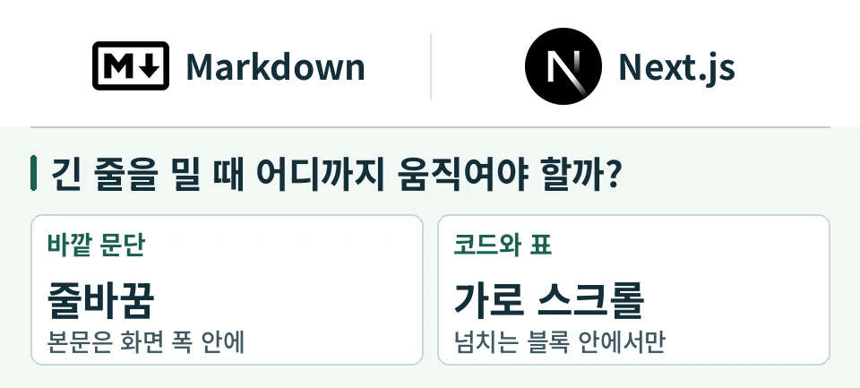

# 모바일에서 긴 코드 한 줄 때문에 본문 전체가 밀릴 때

휴대폰으로 기술 글을 읽는데, 표 하나를 본 뒤부터 문단도 좌우로 밀어야 한다면 불편하다. 그렇다고 긴 코드에 강제 줄바꿈을 넣으면 원래 한 줄이었던 명령을 읽기 어렵다. 0plan 블로그의 수정 기준은 **가로 스크롤을 없애는 것**이 아니라 **어디에서만 스크롤할 수 있게 할 것인가**였다.

긴 코드의 오른쪽 끝을 보려고 밀었을 때 **바로 위 문단의 첫 글자는 제자리에 있어야** 한다. 같은 동작으로 수정 전후를 구별할 수 있다.

## 문단과 코드와 표의 폭은 다르게 취급한다

한국어 문단에는 가급적 단어를 잘게 쪼개지 않는 `word-break: keep-all`을 적용하고, 긴 주소처럼 도저히 들어가지 않는 문자열은 `overflow-wrap: anywhere`로 줄을 넘길 수 있게 했다. 코드 블록은 반대다. 공백과 줄 구조를 유지하고, 안 들어가는 줄은 블록 안에서만 좌우로 읽는다. 표 역시 셀을 한 글자 폭으로 찌그러뜨리지 않고 바깥 래퍼에서만 스크롤하도록 했다.

표 래퍼에는 포커스를 받을 수 있는 스크롤 영역이라는 이름도 붙였다. 터치로 밀 수 있는 영역이 키보드 사용자에게는 닿지 않는다면 절반만 만든 것이다. 반면 표의 정렬 속성이나 목록 체크박스까지 새로 구현하지는 않았다. Markdown 변환기가 만들어 준 요소와 속성을 그대로 남겨야 작성자가 지정한 의미가 보존된다.

## 실서비스 글 하나보다 까다로운 시험 원고 한 장

서로 다른 문제를 한 번에 볼 수 있도록 시험 원고에 **두 문단짜리 인용문과 중첩 목록, 오른쪽 정렬 표, 체크리스트, 긴 코드, 설명이 있는 이미지**를 넣었다. 컴파일된 HTML에서 표 정렬과 이미지 설명이 유지되는지, 문단 안에 문단이 중첩되지 않는지도 확인했다. CSS로 얼핏 비슷하게 보인다는 것과 문서 구조가 바르다는 것은 다르기 때문이다.

같은 CSS의 시험 문서를 Chromium에서 폭 320·390·768·1440, 각각 라이트·다크로 열었다. 확인한 것은 페이지 가로 넘침이 없는지, 표와 코드만 내부 스크롤이 생기는지, 이미지 비율이 유지되는지였다. 여덟 조건의 **시험 문서**를 확인한 것이지 모든 실게시물과 실물 휴대폰을 검사한 것은 아니다.

이후 글을 쓸 때도 원고를 화면 폭에 맞춰 잘라 쓰지 않아도 된다. 문장은 읽기 좋게 개행되고, 독자가 긴 한 줄을 끝까지 보고 싶을 때는 그 줄이 들어 있는 상자만 움직인다.

*[그림 출처 및 이용 조건](https://raw.githubusercontent.com/0plan/blog/483cbd2a01d481c65a92f36ec805558f8858debf/assets/images/article-figures/credits.txt)*

## 다음에 읽으면 좋은 글

[브라우저에서는 열리는 한글 글, 옛 링크로는 왜 404였을까?](%ED%95%9C%EA%B8%80%20%EB%B8%94%EB%A1%9C%EA%B7%B8%20%EC%A3%BC%EC%86%8C%EC%9D%98%20404.md) — 표현을 다룰 때와 마찬가지로, 링크에서도 파일명의 의미와 화면에 보이는 문자열을 구분해야 했다.
