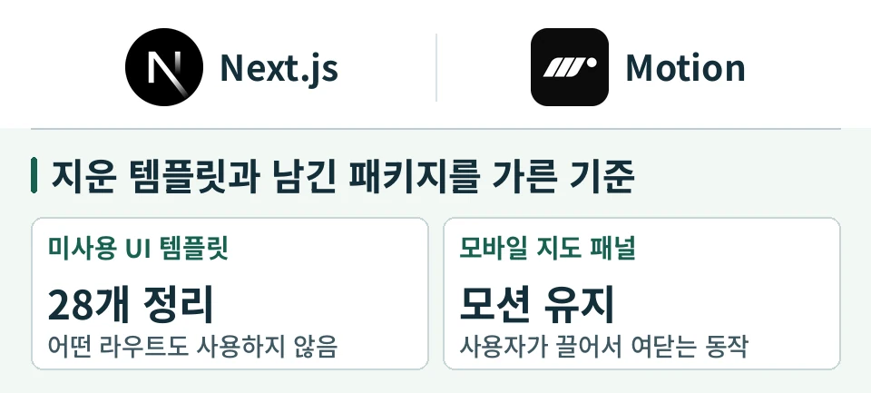

# 직접 의존성 33개를 지우면서 애니메이션 패키지는 남긴 이유

프로젝트가 몇 년을 지나면 설치된 패키지 수와 지금 서비스가 실제로 필요로 하는 패키지 수가 달라진다. 0plan 웹 앱에는 미리 복사해 둔 UI 템플릿이 여럿 남아 있었다. `package.json`에서 하나씩 이름을 골라 지우기 전에 좀 이상한 질문을 해야 했다. **컴포넌트가 라이브러리를 import한다는 사실만으로, 우리 화면이 그 라이브러리를 쓰는 걸까?**

패키지를 남긴 근거는 화면에서 손으로 재현할 수 있다. 휴대폰에서 **충전소 목록의 손잡이를 끌었다 놓으면** 패널이 다음 위치에 붙는다.

## 패키지 이름에서 시작하지 않고 화면으로 들어갔다

예를 들어 템플릿 A가 패키지 B를 읽지만 어떤 라우트도 A를 렌더링하지 않는다면, `B`를 검색할 때마다 A라는 참조가 나온다. 검색 결과는 맞고 ‘그러니 운영에 필요하다’는 결론은 틀릴 수 있다. 반대로 페이지에서 직접 import하지 않아도 공용 메뉴나 지도 패널을 거쳐 쓰는 라이브러리는 있다. 이름 검색과 실제 호출 경로를 함께 보는 이유다.

이번 감사에서는 132개 파일의 참조를 검토하고, 쓰이지 않는 UI 템플릿 28개와 연결된 의존성을 정리했다. 직접 의존성 기준으로 33개가 빠졌다. **`framer-motion`은 남겼다.** 화면에서 움직이는 장식 하나 때문이 아니라, 충전소 지도의 모바일 하단 패널을 끌어 내리고 스냅시키는 동작과 카드 모션에 실제로 쓰이고 있었다. 패키지를 지우려다 사용자가 손으로 하던 동작까지 지우면 정리가 아니다.

## 어제의 `node_modules`로는 오늘의 삭제를 검증할 수 없다

기존 설치 디렉터리가 있으면 이미 지웠다고 생각한 모듈이 우연히 남아 빌드를 통과할 수 있다. 그래서 잠금 파일을 다시 만든 뒤 **깨끗한 환경에서 잠금 파일 그대로 설치**해 검증했다. 이 상태에서 테스트, URL 검사, 타입 검사, 린트와 프로덕션 빌드가 통과했다. CI에 운영 블로그와 API 설정은 없었으므로 그 빌드가 실서비스 데이터까지 불러오는 시험을 대신한 것은 아니다.

이 기록에서 가장 중요한 숫자는 33이 아니다. 다음 사람이 `framer-motion`이 왜 남았는지 물으면 ‘아직 못 지웠다’가 아니라 **‘모바일 지도에서 이 핸들을 끌 때 쓰인다’**고 답할 수 있다는 점이다. 그런 답이 있는 패키지는 수가 하나 많아도 빚이 아니다.

*[그림 출처 및 이용 조건](https://raw.githubusercontent.com/0plan/blog/483cbd2a01d481c65a92f36ec805558f8858debf/assets/images/article-figures/credits.txt)*

## 다음에 읽으면 좋은 글

[Next.js 빌드에 필요했던 1GB가 운영 컨테이너에도 필요할까?](Next.js%20%EB%B9%8C%EB%93%9C%EC%99%80%20%EC%9A%B4%EC%98%81%20%EC%9D%B4%EB%AF%B8%EC%A7%80%EC%9D%98%20%ED%81%AC%EA%B8%B0.md) — 개발에 꼭 필요한 패키지를 지우지 않고도 배포물에서 제외하는 방법을 다룬다.
