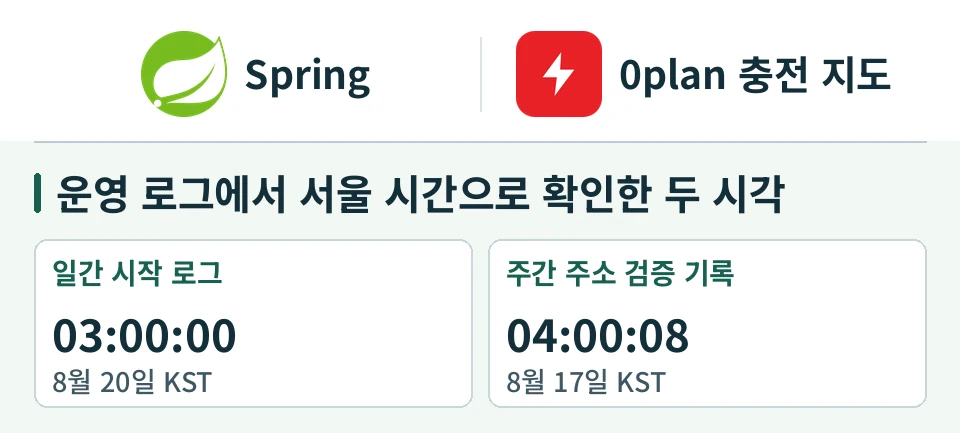

# ‘새벽 3시 배치’는 어느 나라의 새벽일까?

0plan 슈퍼차저 동기화 코드에는 ‘새벽 3시(UTC)’라는 주석이 있었다. 주간 주소 보정 옆에는 ‘04:00 UTC = 13:00 KST’라고 쓰여 있었다. 두 설명을 믿고 한국 시간 오후 1시에 로그를 찾으면 이상한 결론에 도달한다. **실제 운영 배치는 그 시간에 실행된 적이 없어도 정상**이었기 때문이다.

왼쪽은 **시작 로그**, 오른쪽은 **주소를 검사하면서 남긴 시각**이다. 여덟 초의 차이를 스케줄러의 지연으로 읽을 근거는 없다.

## 주석, 스케줄 식, 실행 시각을 따로 읽었다

당시 Spring 스케줄 표현식에는 시간대를 고정하는 값이 없었다. 이 경우 숫자 `3`을 어느 시간대의 3시로 해석할지는 실행 환경에 달려 있었다. 운영 컨테이너는 서울 시간대를 쓰고 있었다. 확인에 도움이 된 것은 설정 한 줄보다 이미 남아 있던 두 기록이었다.

| 작업 | 운영에서 확인한 시각 |
|---|---|
| 일간 동기화 | 2026-08-20 **03:00:00 KST**에 시작 로그 |
| 주간 주소 보정 | 2026-08-17 월요일 **04:00:08 KST**에 주소 검증 시각 기록 |

두 번째 값은 주소에 남은 처리 시각이지, 스케줄러가 정확히 8초에 발화했다는 뜻은 아니다. 그래도 월요일 오후 1시에 처리됐다는 설명과는 맞지 않는다.

## 시간을 바꾸지 않는 수정

여기서 숫자 `3`을 UTC 기준으로 환산해 바꾸면, 문서 오류를 고치려다 멀쩡히 돌던 작업을 아홉 시간 옮길 수 있다. 지키고 싶은 동작은 **한국 시간 매일 03시, 매주 월요일 04시**였다. 그래서 시·분은 유지하고 스케줄에 `zone = "Asia/Seoul"`을 명시했다. 주석도 그 시각에 맞췄다. 다른 시간대를 기본값으로 쓰는 컨테이너에서 실행해도 ‘3시’의 기준은 서비스 코드에 남는다.

배치 시각을 넘겨받을 때 이제는 질문을 이렇게 나눈다. **“언제 돌기를 원하는가?”, “프로그램은 어느 시간대로 해석하는가?”, “지난번에는 실제로 언제 돌았는가?”** 답 셋이 맞으면 그때부터 ‘어젯밤 동기화 결과가 최신인가?’를 따질 수 있다.

*[그림 출처 및 이용 조건](https://raw.githubusercontent.com/0plan/blog/483cbd2a01d481c65a92f36ec805558f8858debf/assets/images/article-figures/credits.txt)*

## 다음에 읽으면 좋은 글

[영문 주소만 있던 충전소에 한글 주소를 붙이는 기준](%EC%B6%A9%EC%A0%84%EC%86%8C%EC%97%90%20%ED%95%9C%EA%B8%80%20%EC%A3%BC%EC%86%8C%EB%A5%BC%20%EB%B6%99%EC%9D%B4%EB%8A%94%20%EA%B8%B0%EC%A4%80.md) — 정상 시각에 배치가 돌아도 기존 규칙으로는 왜 일부 주소가 보완되지 않았는지 다룬다.
