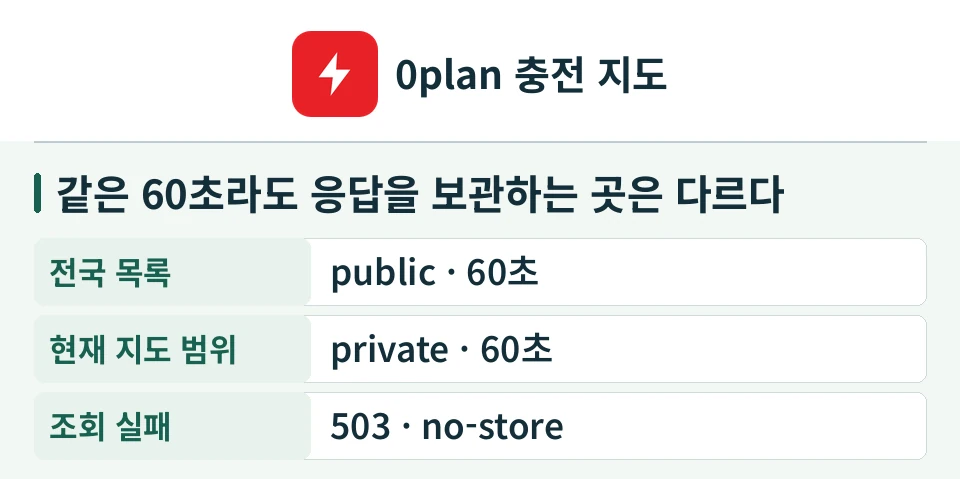

# 같은 충전 지도인데 왜 전국 목록만 공유 캐시에 넣을까?

전국의 NACS 충전소 목록을 여는 두 사람은 같은 목록을 요청한다. 반면 한 사람은 집 근처를, 다른 사람은 여행지를 확대하고 있다면 사각형의 위도·경도로 조회하는 충전소 목록은 다르다. 둘 다 공개 충전소 데이터인데 **요청 안에 담긴 정보**는 같지 않다.

마지막 줄에는 ‘0초’라고 쓰지 않았다. 잠깐만 보관하라는 응답과 **저장하지 말라는 응답**은 다르다.

## 60초는 같고, 사본을 두는 곳은 다르다

0plan의 웹 서버는 브라우저 대신 백엔드에 요청을 보내고 결과를 돌려준다. 전국 목록은 이용자가 달라도 응답이 같아 브라우저와 공유 캐시가 성공 응답을 **60초** 재사용할 수 있게 했다. 운영 상태도 들어 있는 데이터이므로 하루 종일 같은 응답을 써도 된다고 하지는 않았다.

지도 영역 조회에는 보고 있는 곳의 경계 좌표가 들어 있다. 실제 사용자 위치와 반드시 같지는 않아도 **관심 지역**을 드러낼 수 있다. 그래서 이 응답은 `private, max-age=60`으로 기기 캐시에서만 재사용하도록 했다. `private`가 좌표를 서버나 로그에서 지우는 것은 아니다. 다른 이용자에게도 응답을 제공하는 공유 캐시에 저장하지 말라는 지시다.

| 응답 | 캐시 정책 |
|---|---|
| 전국 NACS 목록 성공 | `public, max-age=60, s-maxage=60` |
| 현재 지도 범위 조회 성공 | `private, max-age=60` |
| 백엔드 오류·연결 실패 | `503`, `no-store` |

## 충전소가 없는 것과 충전소를 못 가져온 것

예전에는 백엔드 조회에 실패해도 웹 서버가 빈 배열과 `200`을 보냈다. 지도는 빈 화면으로 계속 동작하지만, 이 동작에 성공 응답 캐시를 그대로 덧붙이면 잠깐의 장애가 **‘이 지역에는 충전소가 없다’는 결과**로 남을 수 있다. 수정 후에도 본문은 빈 배열일 수 있지만, 조회에 실패했으면 `503`과 `no-store`를 함께 보낸다. 반대로 정상 조회 결과가 정말 0곳인 경우는 성공 응답이다.

캐시를 넣는다는 말만으로 결정되지 않는 것은 세 가지였다. **누구와 같은 답을 써도 되는지, 얼마 동안 같은 답을 믿을지, 실패도 답으로 남길지.** 특히 세 번째를 먼저 정해 두니 지도를 빠르게 하려다 장애를 오래 보이게 만드는 일을 피할 수 있었다.

*[그림 출처 및 이용 조건](https://raw.githubusercontent.com/0plan/blog/483cbd2a01d481c65a92f36ec805558f8858debf/assets/images/article-figures/credits.txt)*

## 다음에 읽으면 좋은 글

[지도 타일을 정상적으로 받았는데 도로 대신 안내문이 떴다](%EC%A7%80%EB%8F%84%20%ED%83%80%EC%9D%BC%EC%97%90%20%EB%8F%84%EB%A1%9C%20%EB%8C%80%EC%8B%A0%20%EC%95%88%EB%82%B4%EB%AC%B8%EC%9D%B4%20%EB%9C%AC%20%EC%9D%B4%EC%9C%A0.md) — HTTP 요청이 성공했다는 것과 사용자에게 필요한 지도 내용이 왔다는 것도 구분해야 했다.
