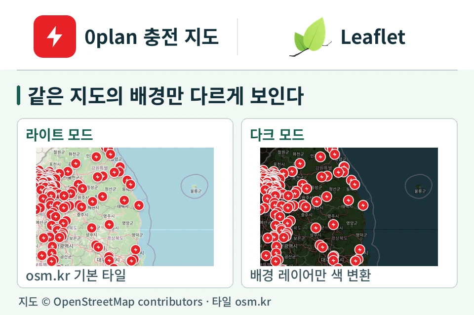

# 지도 타일을 정상적으로 받았는데 도로 대신 안내문이 떴다

0plan 충전 지도에서 다크 모드를 열었더니 도로와 지명 대신 `API KEY REQUIRED`가 칸마다 반복됐다. 깨진 이미지 아이콘이 아니었다. 개발자 도구로 보니 **서버가 256×256 PNG 안에 안내문을 그려 보낸 것**이었다. 브라우저 입장에서는 제대로 받은 그림이었다. 독자 입장에서만 지도가 아니었다.

11월 27일 공개 지도의 같은 영역을 두 테마로 열어 캡처했다. **현재 지도**를 비교한 것이고, 예전에 받았던 오류 타일을 재현한 화면은 아니다. 목록과 출처가 보이는 [라이트 전체 화면](https://raw.githubusercontent.com/0plan/blog/483cbd2a01d481c65a92f36ec805558f8858debf/assets/images/article-figures/charger-map-light.webp)과 [다크 전체 화면](https://raw.githubusercontent.com/0plan/blog/483cbd2a01d481c65a92f36ec805558f8858debf/assets/images/article-figures/charger-map-dark.webp)도 남겼다. 지도 데이터 © [OpenStreetMap 기여자](https://www.openstreetmap.org/copyright), 타일 [osm.kr](https://osm.kr/).

## 고칠 대상은 지도의 어느 층인가?

당시 밝은 모드는 한반도 지도를 제공하는 osm.kr 타일을, 어두운 모드는 다른 제공자의 타일을 사용했다. 충전소 이름과 상태를 나타내는 마커는 두 배경 위에 따로 그렸다. 그렇다면 어둡게 하기 위해 데이터 제공자까지 바꿔야 할까?

수정 후에는 양쪽 모드가 같은 osm.kr 타일을 쓰고, 다크 모드일 때 **배경 타일 레이어에만** 색 반전·색조·채도·밝기 필터를 적용한다. 지도 컨테이너 전체에 필터를 씌우면 충전 사업자를 구분하는 마커 색과 팝업까지 바뀐다. 배경을 바꾸려던 일이 데이터의 의미를 바꾸지 않도록 경계를 좁혔다. 이 선택에는 한계도 있다. 한반도용 타일이므로 해외 좌표까지 보여 주는 세계 지도의 해법은 아니다.

## 직접 확인할 때는 ‘200 PNG’에서 한 단계 더

로컬 앱을 실제 타일 서버에 연결하고 Chromium 폭 360·390·1280에서 다크 → 라이트 → 다크로 바꿨다. 세 폭에서 각각 8장·8장·24장의 타일이 디코딩됐고 테마 전환에 따른 추가 타일 요청은 0이었다. 이번에는 파일 형식에서 끝내지 않고 **서울·춘천 지명과 도로가 읽히는지, 충전소 마커는 원래 색인지**도 봤다.

작은 화면에서는 아래의 충전소 목록이 지도 출처를 덮는 문제가 있었다. 모바일의 출처 링크를 왼쪽 위로 옮기고 목록이 열린 상태에서 OpenStreetMap과 osm.kr 링크를 누를 수 있는지 확인했다. 이번 수정의 완료 기준은 ‘검은색 지도가 떴다’가 아니라 **지명·마커·출처가 각자 하던 일을 계속한다**는 것이었다.

*[그림 출처 및 이용 조건](https://raw.githubusercontent.com/0plan/blog/483cbd2a01d481c65a92f36ec805558f8858debf/assets/images/article-figures/credits.txt)*

## 다음에 읽으면 좋은 글

[서울에서는 왜 지도를 확대해도 이름표가 계속 겹쳤을까?](%ED%99%94%EB%A9%B4%20%EC%95%88%20%EC%B6%A9%EC%A0%84%EC%86%8C%20%EC%88%98%EB%A1%9C%20%EC%9D%B4%EB%A6%84%ED%91%9C%20%EB%B0%80%EB%8F%84%20%EC%A1%B0%EC%A0%88%ED%95%98%EA%B8%B0.md) — 배경이 제대로 보여도 그 위에 어느 글자까지 얹을지는 별도 문제다.
