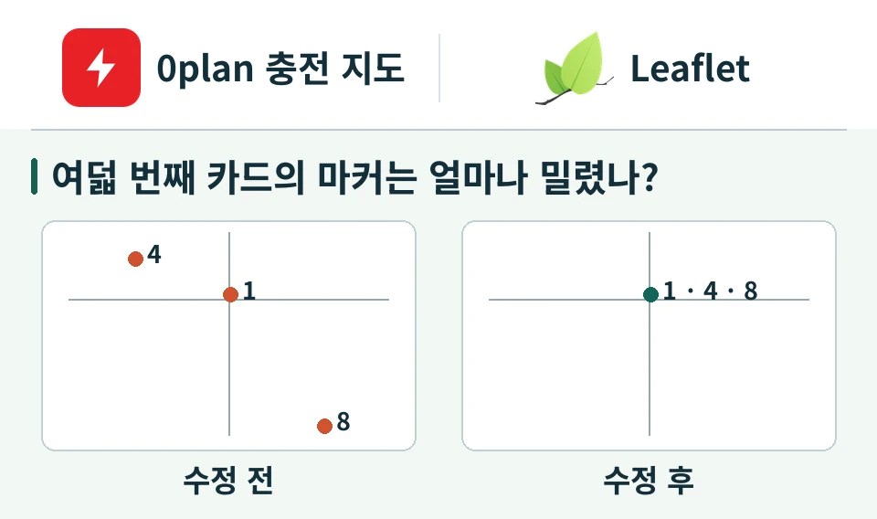

# 충전소를 눌렀는데 마커가 화면 모서리에 뜬 이유

충전소 목록에서 카드를 누르면 지도는 그 충전소로 이동하고 팝업을 연다. 얼핏 단순한 동작인데, 어떤 카드는 가운데에 오고 어떤 카드는 화면 맨 아래에 붙었다. 좌표가 잘못 저장된 것이라면 같은 장소가 항상 같은 방식으로 어긋나야 한다. 여기서는 **팝업이 얼마나 큰지에 따라 밀리는 양도 달랐다.**

십자선의 교점은 지도에서 실제로 보이는 부분의 중심이고, 숫자는 누른 카드 순서다. 수정 후 점 하나만 보이는 건 **세 번 모두 같은 자리에 도착했기 때문**이다.

## ‘중심’부터 숫자로 정했다

기준은 브라우저 창 전체가 아니라 **목록 패널을 빼고 실제 지도가 보이는 영역의 중심**이다. 1440×900 화면에서 카드 세 개를 눌러, 마커가 그 점에서 몇 픽셀 떨어졌는지 측정했다. `dx`는 오른쪽, `dy`는 아래쪽이 양수다.

| 누른 카드 | 수정 전 `(dx, dy)` | 수정 후 `(dx, dy)` |
|---|---:|---:|
| 첫 번째 | `(8, -14)` | `(8, -14)` |
| 네 번째 | `(-328, -141)` | `(8, -14)` |
| 여덟 번째 | `(340, 449)` | `(8, -14)` |

첫 카드만 눌러 봤으면 수정할 이유조차 발견하지 못했을 것이다.

## 지도와 팝업이 연달아 지도를 움직였다

목록을 누르면 Leaflet의 `fitBounds`로 목적지까지 애니메이션을 시작한 다음, 바로 `openPopup()`을 호출했다. 팝업도 화면 밖으로 나가지 않게 지도를 미는 기능이 있다. 아직 움직이는 중인 지도를 기준으로 팝업이 한 번 더 밀면서, 최종 위치는 처음 계산한 중심에서 멀어졌다.

지도가 멈추는 이벤트를 기다리는 방법도 떠오른다. 하지만 이미 보고 있는 충전소를 다시 누르면 이동 자체가 없을 수 있다. 발생하지 않는 `moveend`를 기다리면 이번에는 팝업이 열리지 않는다. 그래서 **목록 선택에 의한 이동만 즉시 끝내고, 확정된 위치에서 팝업을 열었다.** 마커 좌표나 지도 데이터는 고치지 않았다.

수정 후 세 카드 모두 같은 작은 오프셋에 모였다. 아이콘 크기 안쪽인 `(8, -14)`를 없애려고 좌표에 보정값을 더할 이유는 없었다. 900×700 화면과 390×844 모바일에서도 같은 기준으로 확인했다. 지도 버그를 다시 만났을 때 먼저 볼 것은 위도·경도만이 아니다. **마지막으로 화면을 움직인 주체가 누구였는가?**

*[그림 출처 및 이용 조건](https://raw.githubusercontent.com/0plan/blog/483cbd2a01d481c65a92f36ec805558f8858debf/assets/images/article-figures/credits.txt)*

## 다음에 읽으면 좋은 글

[서울에서는 왜 지도를 확대해도 이름표가 계속 겹쳤을까?](%ED%99%94%EB%A9%B4%20%EC%95%88%20%EC%B6%A9%EC%A0%84%EC%86%8C%20%EC%88%98%EB%A1%9C%20%EC%9D%B4%EB%A6%84%ED%91%9C%20%EB%B0%80%EB%8F%84%20%EC%A1%B0%EC%A0%88%ED%95%98%EA%B8%B0.md) — 같은 지도에서 이번에는 중심점 대신 한 화면에 표시된 이름표 수를 쟀다.
