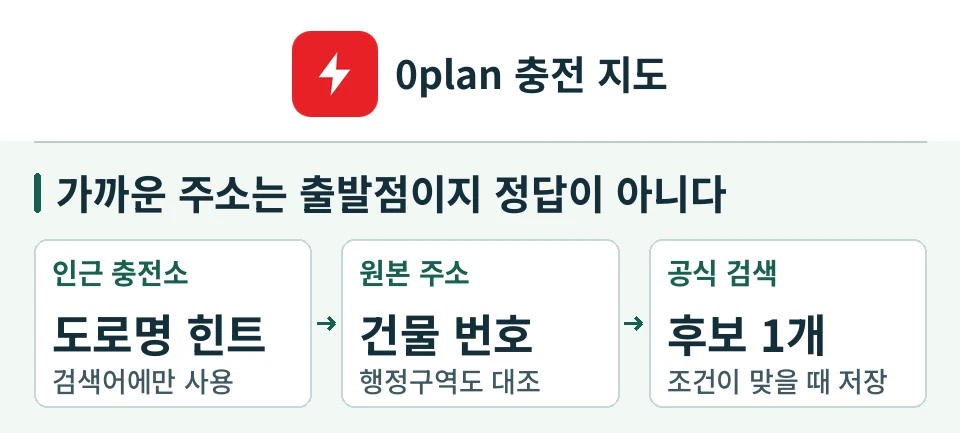

# 영문 주소만 있던 충전소에 한글 주소를 붙이는 기준

0plan 충전소 API는 정상 응답을 주는데, 국내 충전소 두 곳의 주소는 영어로만 나왔다. 매일 동기화하고 매주 주소도 보정한다는데 왜 한글 칸은 계속 비어 있을까? 운영 데이터를 보니 **일간 작업은 영문 주소를 저장하고, 주간 보정은 이미 한글 도로명이 있는 곳에서 출발**했다. 두 작업이 모두 예정대로 돌아가도 빈칸을 처음 채우는 담당은 없었다.

그림의 첫 칸에서 가져오는 것은 **검색에 쓸 단어**다. 내비게이션에 보여 줄 주소가 되는 건 마지막 칸을 통과한 뒤다.

## 옆 충전소가 가까워도 같은 주소는 아니다

가장 손쉬운 방법은 좌표가 가까운 전기차 충전소의 한글 주소를 가져오는 것이다. 하지만 가까운 주차장과 길 건너편은 좌표상 비슷해도 도로명이나 건물 번호가 다를 수 있다. 특히 운전자는 잘못된 주소를 믿고 반대편 진입로로 갈 수 있다. 그래서 인근 충전소의 주소는 **검색어를 만들 때만** 썼다. 인근 도로명을 빌리되 건물 번호는 원래 충전소의 영문 주소에서 가져온다.

저장할 근거는 공식 주소 검색이 돌려준 한·영 주소 쌍이다. 영문 도로명과 건물 번호, 시도와 시군구가 원본을 가리키는지 비교하고, 원본에 우편번호가 있으면 그것도 대조한다. 조건을 통과한 후보가 하나일 때만 사용한다. 둘 중 어느 쪽인지 모를 때는 빈칸이 오답보다 낫다.

## 조회할 때뿐 아니라 저장할 때도 지킬 것

기존에 한글 주소가 채워진 곳은 검색 대상에서 뺐다. 하지만 후보를 읽은 순간에는 비어 있어도, 공식 주소 응답을 기다리는 동안 사람이 수정할 수 있다. 따라서 실제 저장 쿼리에도 **기존 한글 도로명이 아직 비어 있는지** 조건을 둔다. 처음 읽은 원본 영문 주소가 바뀌었다면 오래된 조회 결과로 새 주소를 덮지 않도록 원본도 대조한다.

운영 조사에서 영문 주소만 있었던 두 지점에 대해 공식 서비스가 대응하는 한글 도로명·건물 번호를 반환하는 것까지 확인했다. 이것이 모든 국내 충전소가 자동으로 한글화됐다는 뜻은 아니다. 목표는 완성률 숫자를 올리는 것보다 **화면에 한글 주소를 보여 줄 때 그 주소를 왜 골랐는지 설명할 수 있게 하는 것**이었다.

*[그림 출처 및 이용 조건](https://raw.githubusercontent.com/0plan/blog/483cbd2a01d481c65a92f36ec805558f8858debf/assets/images/article-figures/credits.txt)*

## 다음에 읽으면 좋은 글

[‘새벽 3시 배치’는 어느 나라의 새벽일까?](%EC%83%88%EB%B2%BD%20%EB%B0%B0%EC%B9%98%EC%9D%98%20%EA%B8%B0%EC%A4%80%20%EC%8B%9C%EA%B0%84%EB%8C%80.md) — 주소 보정이 무엇을 하는지와 언제 실제로 실행됐는지는 별도로 확인해야 한다.
