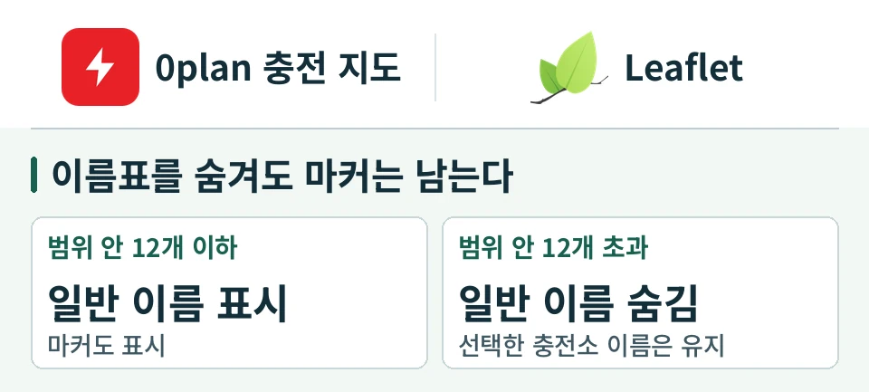
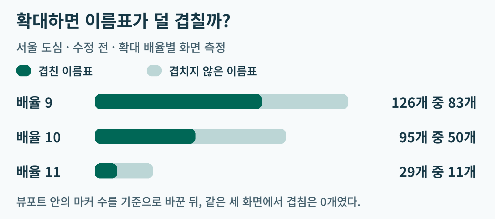

# 서울에서는 왜 지도를 확대해도 충전소 이름표가 겹쳤을까?

전국 지도를 열자마자 모든 충전소 이름을 쓰면 지명이 서로 가려진다. 처음엔 확대 배율로 풀었다. 전국을 볼 때는 숨기고, 일정 배율 이상 확대하면 이름표를 보여 주는 방식이다. 전국 화면은 깨끗해졌다. 문제는 서울 도심에서 한두 단계 확대했을 때였다.

이름이 사라진 충전소도 지도에서 누를 수 있다. **조회 결과를 버리는 것**과 **그 위에 쓰는 글자만 줄이는 것**이 갈리는 지점이다.

## 확대 배율은 글자를 놓을 빈자리의 숫자가 아니다

서울의 같은 구역에서 수정 전 이름표를 세어 봤다. 배율 9에서 **126개 가운데 83개**가 겹쳤다. 배율 10에서는 95개 중 50개, 배율 11에서도 29개 중 11개가 겹쳤다. 전국 화면에서 없앤 문제를 다른 배율로 옮겼을 뿐이었다.

배율이 같은 두 화면이어도 하나는 충전소가 몰려 있고 다른 하나는 듬성듬성할 수 있다. 사용자에게 필요한 기준은 ‘얼마나 확대했는가’가 아니라 **‘지금 이 사각형 안에 이름을 몇 개 써야 하는가’**였다.

## 마커는 남기고, 이름표만 줄였다

지도를 움직이거나 확대·축소한 뒤 현재 보이는 범위에 들어오는 충전소를 센다. 0plan에서는 **12개를 넘으면 일반 이름표를 숨기고**, 마커는 그대로 남겼다. 사용자가 고른 충전소 이름은 예외로 보여 준다. 빽빽한 곳에서 모든 이름을 한 번에 읽기는 포기하되, 지금 어느 장소를 선택했는지는 놓치지 않도록 한 것이다.

같은 서울 세 화면을 다시 측정했을 때 겹치는 이름표는 모두 0개였다. 물론 어디에나 통하는 숫자 12를 발견한 것은 아니다. 실제로 약 100m 거리에 붙은 충전소 한 쌍처럼, 화면 전체에 항목이 적어도 두 글자가 국소적으로 겹칠 수 있다. 이런 경우까지 전부 풀려면 글자 상자의 실제 충돌을 계산하는 다른 문제가 된다. 이 지도에서 가장 흔했던 **도심 화면 전체가 이름표에 덮이는 문제**에는 보이는 개수를 세는 것만으로 충분했다.

*[그림 출처 및 이용 조건](https://raw.githubusercontent.com/0plan/blog/483cbd2a01d481c65a92f36ec805558f8858debf/assets/images/article-figures/credits.txt)*

## 다음에 읽으면 좋은 글

[충전소를 눌렀는데 마커가 화면 모서리에 뜬 이유](%EC%B6%A9%EC%A0%84%EC%86%8C%20%ED%8C%9D%EC%97%85%EC%9D%B4%20%EB%A7%88%EC%BB%A4%EB%A5%BC%20%ED%99%94%EB%A9%B4%20%EB%AA%A8%EC%84%9C%EB%A6%AC%EB%A1%9C%20%EB%B0%80%20%EB%95%8C.md) — 화면에서 픽셀로 재 보니 저장 좌표를 손대지 않고 해결할 수 있었던 또 다른 사례다.
