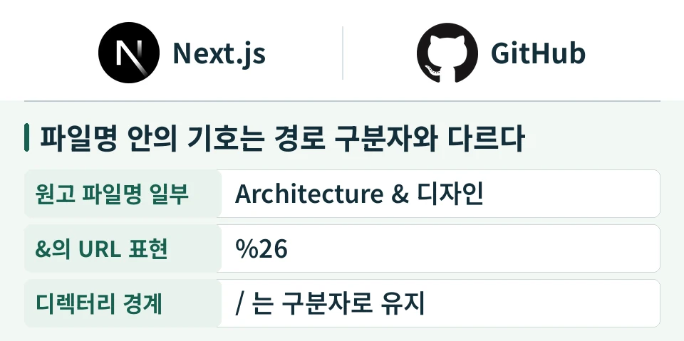

# 브라우저에서는 열리는 한글 글, 옛 링크로는 왜 404였을까?

0plan 블로그의 파일명에는 한글, 공백, 괄호, `&`가 자연스럽게 들어간다. GitHub에서 읽으면 평범한 파일명이다. 하지만 옛 주소에서 새 주소로 보내는 표를 만들 때는 **사람 눈에 같은 이름인지**와 **들어온 URL 문자열이 같은지**가 서로 다른 질문이었다. 운영에서 본 404도 원인 하나가 아니었다.

파일 이름 전체를 바꾸는 게 아니다. 주소를 다시 파일 경로로 풀었을 때 **같은 이름이 돌아와야 한다**는 것이 기준이다.

## 첫 번째: 같은 글을 다른 문자열로 비교했다

예를 들어 `Vite란.md`와 `Vite%EB%9E%80.md`는 같은 파일을 가리킬 수 있다. 당시 리다이렉트 키 29개 중 14개에는 한글 원문과 `%20` 같은 인코딩이 섞여 있었다. 브라우저가 인코딩해서 보낸 경로와 표 안의 값을 글자 단위로 바로 비교하면 일치하지 않았다. 특정 글마다 인코딩 버전을 하나씩 추가하는 대신, **비교할 때 같은 표현으로 맞추는 규칙**을 한곳에 뒀다.

## 두 번째: 파일명의 `&`는 HTML 엔티티가 아니다

`Clean Architecture & 디자인 패턴 기초.md` 같은 이름을 그대로 링크에 넣으면, HTML로 직렬화하는 시점에 `&`가 `&amp;`로 보인다. 정상 브라우저는 그것을 다시 해석하지만, 운영에서는 세미콜론까지 경로의 일부인 것처럼 되돌려 보낸 크롤러 요청도 있었다.

해결 지점은 출발점이었다. GitHub 파일 경로를 `/`로 나누고 **파일명·폴더명 각각**을 URL에 맞게 인코딩한다. 그러면 파일명 속 `&`는 처음부터 `%26`이 되고, 경로를 나누는 `/`는 살아 있다. HTML에서 보인 철자부터 수리하거나 예약문자를 한 글자씩 수동 치환할 필요가 없다.

## 세 번째: 제대로 이동했는데 도착할 파일이 없었다

인코딩이 맞아도 404가 남은 옛 홈서버 글이 있었다. SSL 설정 내용을 보강하면서 실제 파일 이름이 바뀌었는데, 리다이렉트의 마지막 단계는 옛 이름에서 끝나고 있었다. 이건 문자열 함수를 고쳐도 낫지 않는다. 당시 체인 29개를 콘텐츠 저장소의 실제 파일과 대조해 이 종착지를 연결했다.

그래서 URL 검사에는 두 종류의 예를 남겼다. 한글 원문과 인코딩된 요청이 같은 곳에 닿는지, 파일명으로 만든 링크를 다시 풀었을 때 원래 이름으로 돌아오는지다. 그리고 글 이름을 바꿀 때는 **그 링크가 결국 존재하는 파일로 끝나는가**를 별도로 본다. 외부에 한 번 공유한 글 주소는 폴더 정리보다 오래 산다.

*[그림 출처 및 이용 조건](https://raw.githubusercontent.com/0plan/blog/483cbd2a01d481c65a92f36ec805558f8858debf/assets/images/article-figures/credits.txt)*

## 다음에 읽으면 좋은 글

[모바일에서 긴 코드 한 줄 때문에 본문 전체가 밀릴 때](%EB%AA%A8%EB%B0%94%EC%9D%BC%EC%97%90%EC%84%9C%20%EA%B8%B4%20%EC%BD%94%EB%93%9C%EC%99%80%20%ED%91%9C%EA%B0%80%20%EB%B3%B8%EB%AC%B8%EC%9D%84%20%EB%B0%80%20%EB%95%8C.md) — 파일을 찾은 다음에는 같은 Markdown이 작은 화면에서도 읽히는지 확인할 차례다.
