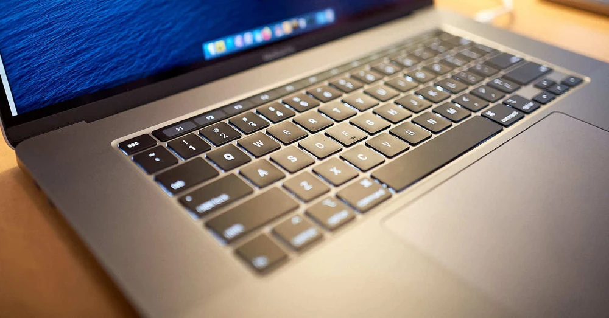
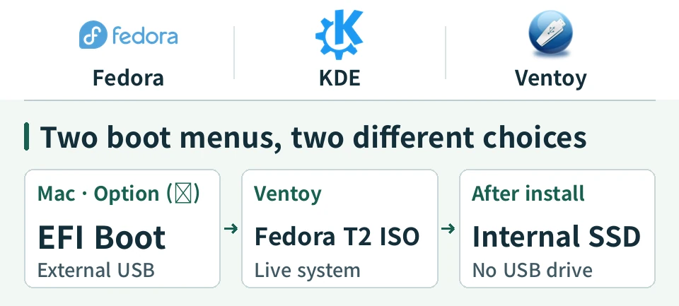
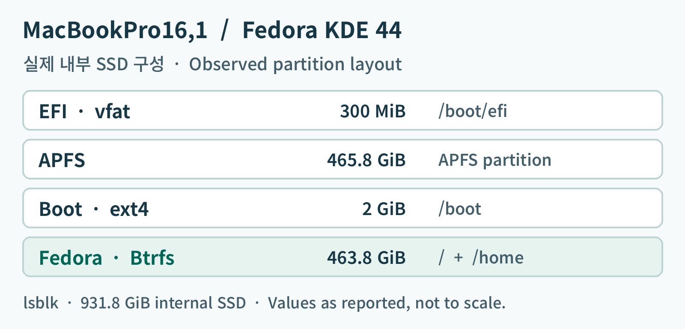

# Installing Fedora KDE on a T2 MacBook Pro: Ventoy USB and EFI boot recovery

[한국어로 읽기](../한국어/1.%20Fedora%20KDE%20설치와%20EFI%20부팅%20복구.md) · [Series index](../index.md)

I installed Fedora KDE from a Ventoy USB drive, but the Mac wouldn't boot Fedora from its internal SSD. On November 4, the boot logs pointed to the **300 MiB internal EFI system partition**. It had just 168 KiB free, and `shimx64.efi`, the file the Mac was trying to launch, was missing.

The machine I wanted to use as a home development server was a **MacBookPro16,1** with an Intel i9-9980HK, 64 GB of RAM, a Radeon Pro 5500M and Apple's T2 chip. The t2linux guide covers how to prepare the installation. To find out why *this* machine wouldn't start, I had to look at what it tried to run without the USB drive.

This [2019 16-inch MacBook Pro was photographed by Jack Baty](https://commons.wikimedia.org/wiki/File:2019_16-inch_MacBook_Pro_%2849183242933%29.jpg) ([CC BY-SA 2.0](https://creativecommons.org/licenses/by-sa/2.0/); resized and converted to WebP). The installation and recovery below were on my own machine, not the one in the photo.

## Before writing the USB drive

1. **Decide what stays on the Mac.** This machine still has an APFS partition. For a dual-boot installation, back up important files, then use macOS Disk Utility to allocate a separate **partition** for Linux. Adding a volume inside the existing APFS container is not the same thing. Write down the new partition's size and name: you will need to identify it in a different installer.
2. **Put the Fedora ISO on a Ventoy drive.** [Ventoy](https://www.ventoy.net/en/doc_start.html) is installed on the USB drive once. A fresh installation formats the target, so identify the external drive by name and size and save anything you need from it first. Once Ventoy is installed, copy the [T2-aware Fedora ISO](https://github.com/t2linux/fedora-iso/releases) to the drive's large data partition **as an `.iso` file**. Don't extract it or write it over the entire drive. Ventoy lets you select the file at boot.
3. **Allow the Mac to boot the installer.** The [t2linux pre-install guide](https://wiki.t2linux.org/guides/preinstall/) walks through macOS Recovery (`⌘R`) and Startup Security Utility. For this Linux installation path, choose **No Security** under Secure Boot and allow booting from external or removable media. That changes the machine's boot protection. Once Fedora boots from the internal SSD, you can reconsider whether external boot still needs to be allowed.

## Booting the Ventoy USB: choose a drive on the Mac, then an ISO in Ventoy

*Diagram: 0plan · [Fedora, KDE and Ventoy logo credits](../index.md#image-credits)*

Booting the USB involves **two different menus**. Hold **Option (⌥)** while powering on and select the external drive's **EFI Boot** entry in the Mac's Startup Manager. Then select the **Fedora ISO in Ventoy's menu** to start the live environment. The first menu chooses a *device*; the second chooses a *file on that device*.

My Ventoy drive actually held **two images**: regular Fedora KDE and the T2 build. The T2 image for this Mac was `Fedora-t2linux-KDE-Desktop-Live-44.0.x86_64.iso`. A missing USB entry in Startup Manager and a missing ISO inside Ventoy are two different problems.

## Once the live environment starts: install to the internal SSD

Check display and input in the live environment, then follow the [t2linux Fedora installation guide](https://wiki.t2linux.org/distributions/fedora/installation/). In the installer, identify the internal SSD and match the reserved Linux space by size. For a dual boot, reclaim **only the partition prepared for Linux**. A whole-disk install would not preserve the existing system. Reuse the EFI system partition at `/boot/efi` without formatting it. When the installer finishes, remove the USB drive, restart and select Fedora's internal boot entry. If Wi-Fi is unavailable, check the [T2 wireless firmware guide](https://wiki.t2linux.org/guides/wifi-bluetooth/) for the firmware path appropriate to the model before deciding to reinstall.

## Fedora wouldn't boot from the internal SSD: where was `shimx64.efi`?

From macOS I mounted the internal EFI partition (`disk0s1`) read-only and compared it with the boot targets in `BOOT-2.LOG` and `BOOT-8.LOG`. Both pointed to `\EFI\fedora\shimx64.efi` on that partition. The file wasn't there. Neither were `grubx64.efi` and `mmx64.efi`.

This Mac had two partitions with “boot” in their Linux mount paths. The nearly full one was **the 300 MiB `/boot/efi` shared by Apple and Fedora**. Fedora's own `/boot` was a separate 2 GiB partition. At the time, EFI had 172,032 bytes (168 KiB) free. `EFI/APPLE/CACHES` occupied about 290 MiB. I found all three files on the T2 ISO. Together they took about 5.77 MiB, more than the internal EFI partition had free. I don't have an installer error proving that lack of space was why the files hadn't been copied.

I backed up all 49 files on EFI and verified their hashes before clearing the specific Apple cache files I had identified. I restored the three missing files from the T2 ISO and checked their SHA-256 hashes against the originals. That left **283.39 MiB free**. The same evening I booted **both macOS and Fedora from the internal SSD** without resizing a partition or reinstalling Fedora. The external display started showing corruption *after* Fedora booted; that was the [graphics issue in part 2](2.%20Radeon%20external%20display%20stalls.md).

## What actually ended up on this Mac?

| Item | Observed configuration |
|---|---|
| OS and running kernel | Fedora Linux 44 KDE Plasma Desktop Edition; `7.2.9-310.t2.fc44.x86_64` at the later GPU-fix stage |
| Internal SSD | 931.8 GiB, including a 465.8 GiB APFS partition |
| Boot filesystems | 300 MiB vfat at `/boot/efi`; 2 GiB ext4 at `/boot` |
| Fedora data | 463.8 GiB Btrfs; `/` and `/home` use the same partition |

Those sizes are observations, not a partition recipe. In Fedora, `lsblk -o NAME,SIZE,FSTYPE,MOUNTPOINTS` shows the partition sizes; `df -h /boot/efi /boot` shows **how much free space each filesystem has**. When someone says their “boot partition” is full, it matters which of those two lines they're looking at.

## Read next

[Part 2: Fedora booted. Why did the external display still stall?](2.%20Radeon%20external%20display%20stalls.md) — Fedora could now start from the internal SSD. The next clue was in the graphics driver’s log, not in the EFI files.
