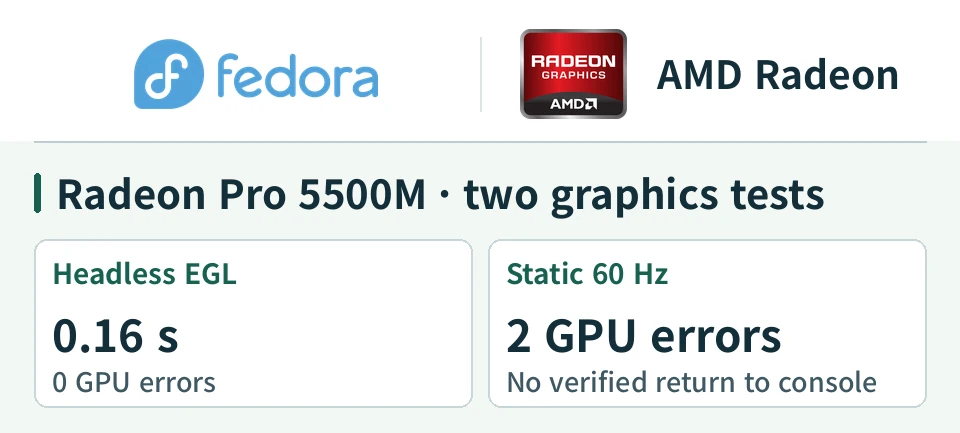

# Fedora on a T2 Mac, part 2: Fedora booted. Why did the external display still stall?

[한국어로 읽기](../한국어/2.%20Radeon%20외부%20화면%20멈춤.md) · [Series index](../index.md)

“The display doesn't work” wasn't a useful diagnosis on this Mac. Its internal panel was physically disconnected; I needed the Radeon Pro 5500M to drive an external screen. Booting Fedora, running a GPU job without a display, and sustaining output to a monitor were three different tests.

*Diagram: 0plan · [Fedora and AMD Radeon logo credits](../index.md#image-credits)*

Both results came from the same GPU on the same day. The test on the left never had to keep an external monitor updated.

## What did the successful tests actually prove?

On November 5, a surfaceless EGL test finished in **0.16 seconds with zero GPU errors**. One 1080p60 output test also finished cleanly after **10.44 seconds**. Had I stopped there, the diagnosis would have been “graphics are fine.” But a separate static 60 Hz test set the display mode and then logged two GPU errors without verifying a return to the console. A page-flip test also set the mode, yet failed to verify a completed flip and recorded three errors.

| Milestone | Question still open |
|---|---|
| A surfaceless EGL job completes | Can the external output change modes and refresh reliably? |
| The requested 60 Hz mode is set | Can it flip frames and return to the console? |
| KDE works with the modified boot entry | Will a separately installed kernel include the same fix? |

## What stayed on this particular machine

I had tried pinning the GPU memory clock (UCLK) at 496 MHz. The GPU's power-management unit, the SMU, continued to report errors. The configuration I kept did **not** pin the clock: the driver used the **95, 496, 598 and 736 MHz values from this GPU's VBIOS**, with the performance policy left on `auto`. The display setup also avoided pipe splitting and disabled the physically disconnected internal panel. Those settings are a record of this machine, not defaults for a Mac with a working internal display.

The modified module and initial boot image went into a separate boot entry. I kept the stock entry as well. That preserved an important distinction: the newest *installed* kernel wasn't necessarily the kernel I had validated with this GPU. Later I could open the KDE desktop remotely, click a menu and type text without recording new GPU errors during that check. The contemporary notes also say that a reboot test after saving the persistent configuration was deferred. A working desktop session was evidence for that session, not a guarantee about the next kernel update.

## Read next

[Part 3: Why did my Mac go to sleep during an SSH session?](3.%20Sleep%20during%20SSH%20sessions.md) — From another computer, a sleeping Mac looked a lot like a stalled one. Resuming in the same boot session was the clue that separated them.
