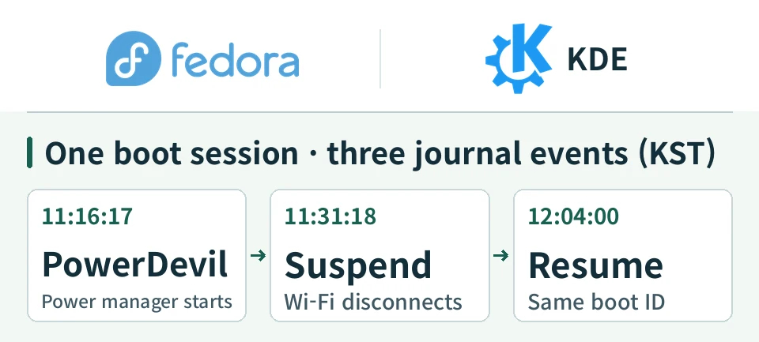

# Fedora on a T2 Mac, part 3: Why did my Mac go to sleep during an SSH session?

[한국어로 읽기](../한국어/3.%20SSH%20작업%20중%20자동%20절전.md) · [Series index](../index.md)

The SSH connection dropped and the Mac disappeared from Wi-Fi. After the graphics trouble, another GPU stall seemed plausible. The first useful fact on reconnection was much simpler: the machine had resumed **in the same boot session**.

*Diagram: 0plan · [Fedora and KDE logo credits](../index.md#image-credits)*

Read the 11:31 entry by itself and it looks like a Wi-Fi fault. Add the entries on either side and the last event is a **wake-up**, not a reboot.

## Put the network event back on its timeline

The November 6 journal showed three events, all in Korean Standard Time:

| Time | Event |
|---|---|
| 11:16:17 | KDE's PowerDevil power manager started. |
| 11:31:18 | Roughly 15 minutes later, the machine entered deep suspend. NetworkManager disconnected Wi-Fi for sleep. |
| 12:04:00 | The same boot session resumed. |

The radio disconnect was a **consequence of sleep**, not the event that put the Mac to sleep. AC power was connected. Neither an open SSH connection nor a running backup process had prevented the desktop session's idle policy from taking effect.

## Closing the lid isn't the same as leaving the keyboard alone

There are two questions hiding in “turn off sleep.” What happens when someone closes the lid? And what happens when the lid stays open but nobody touches the local keyboard for 15 minutes? At the KDE desktop stage I changed both the automatic-suspend action and the lid action in the AC, battery and low-battery profiles. After reloading the configuration, all six settings read back as intended. Critical-battery protection stayed in place. Reading back a setting did not count as another full 15-minute idle test.

Later, when I made `multi-user.target` the default for development-server use, I checked a different thing: **close the real lid and see whether the SSH session remains usable**. It did. That was evidence about lid handling, not a rerun of the earlier KDE idle test. Next time a laptop disappears from the network, I have three questions to ask before touching the wireless driver: did the machine sleep, did it reboot, or did only the network connection go down?

## Read next

[Part 4: A working remote desktop connection that showed only the lock screen](4.%20KDE%20remote%20desktop%20lock%20screen.md) — An awake Mac could take commands over SSH. What would show that a browser could actually control the existing KDE session?
