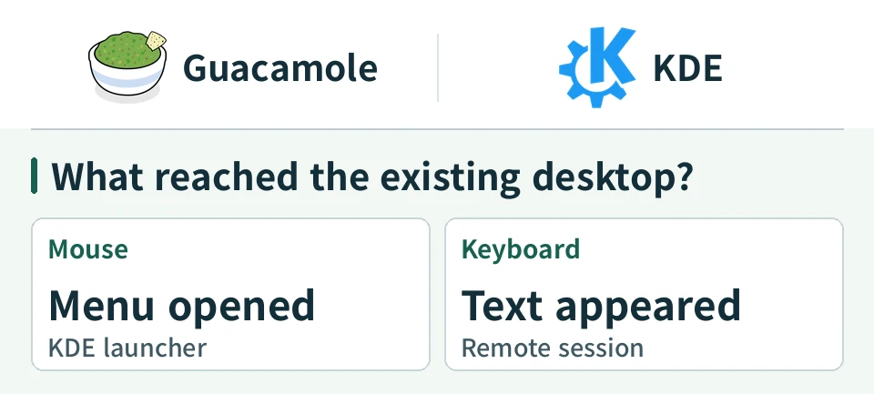

# Fedora on a T2 Mac, part 4: A working remote desktop connection that showed only the lock screen

[한국어로 읽기](../한국어/4.%20KDE%20원격%20데스크톱%20잠금%20화면.md) · [Series index](../index.md)

A KDE lock-screen background appeared in my browser. That was evidence that *something* could get from the Mac to the browser. It wasn't what I needed: I wanted to open a menu and type into the **existing desktop session** without sitting at the machine.

At this stage the browser connected to Guacamole, a web remote-desktop gateway. The gateway used KRDP on the Mac to reach KDE. This was the desktop experiment, before I switched the machine's default boot target for terminal-based development. A logged-in KDE session was part of the setup.

*Diagram: 0plan · [Guacamole and KDE logo credits](../index.md#image-credits)*

These are the actions I verified over the private tunnel. When all I could see was the lock-screen wallpaper, neither had been demonstrated.

## Which desktop was being shared?

In `SharedAccess` mode, locking the local session left the remote user looking at the lock-screen wallpaper. Treating that as a network timeout would have sent me in the wrong direction. `RemoteAccess` mode matched the intended use: an authenticated remote client could use the existing session on a virtual monitor, while the local display switched to the greeter. I also checked that the session was locked again after disconnect. Keeping the unattended Mac's local desktop unlocked wasn't necessary.

## Test two inputs, not just one frame

In the browser test over a private SSH tunnel, I clicked the KDE launcher and typed a test string. The menu opened and the characters appeared **in the remote desktop**. The browser also recorded 217 WebSocket frames and no console errors, but the click and the visible text answered the more important question. A stream of frames can keep arriving even when the person at the keyboard cannot do any work.

Those measurements belong to the private-tunnel test. A public URL redirecting an unauthenticated visitor to the login screen answers yet another question; it does not demonstrate a complete authenticated public input session. Writing down the path, the screen and the action turned “remote desktop works” into a result I could actually repeat.

## Read next

[Part 5: Why did Fedora ask for Fan3 on a two-fan MacBook Pro?](5.%20Fan3%20on%20a%20two-fan%20Mac.md) — Here the useful test was a keystroke. For the fan service, it was watching two actual fan speeds change under load.
