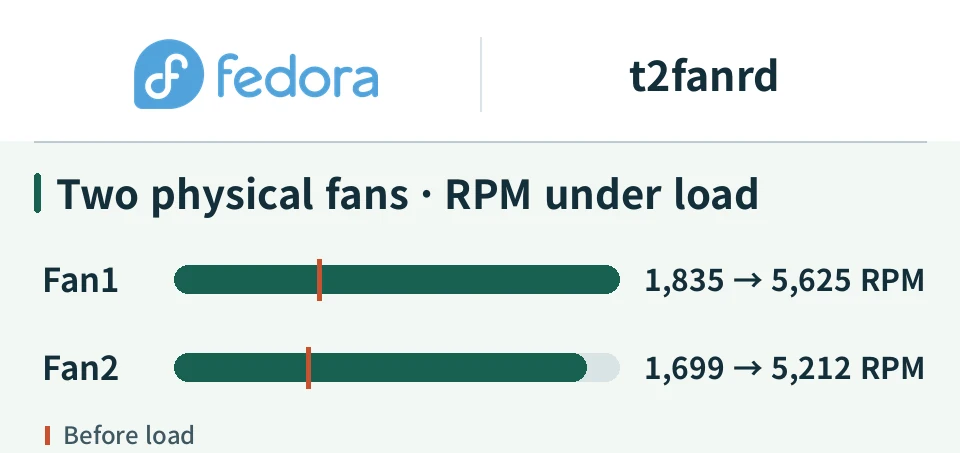

# Fedora on a T2 Mac, part 5: Why did Fedora ask for Fan3 on a two-fan MacBook Pro?

[한국어로 읽기](../한국어/5.%20두%20팬과%20Fan3%20오류.md) · [Series index](../index.md)

The fan-control service stopped as I was turning the Intel Mac into a development server. Its error looked almost like an instruction: `Missing Fan3 in config file`. Should I add a third fan to the configuration?

The same hardware had been running with the same settings minutes earlier. On November 13 a fan-control package was installed at 00:36. At 00:37 the old process exited and its replacement failed to start. The restart counter reached five. Before editing the configuration, it was worth asking **why the program suddenly expected a different number of fans**.

*Diagram: 0plan · [Fedora logo credits](../index.md#image-credits)*

The orange tick marks the speed before load; the end of the green bar marks the speed under load. There was no third physical fan to plot.

## One character at the end of a device name

The daemon enumerated devices through Linux's hardware-monitoring interface. Alongside the laptop fans, it found an AMD GPU entry. It was supposed to skip the device named `amdgpu`. The actual string read from the file was `"amdgpu\n"`: the trailing newline is easy to miss when printing a line to a terminal.

The installed `t2fanrd` build, 0.1.2-1, compared the untrimmed string with `"amdgpu"`. The comparison failed, the GPU entry was counted, and the program went looking for Fan3. The configuration error came **after** the enumeration error. Upstream trimmed the name in build 0.1.2-2. The package manager initially reported `Nothing to do`; refreshing its metadata made the corrected build available. The configuration file's hash was unchanged after the update.

## An active service isn't a spinning fan

With the update installed, the service stayed active with no restarts and no new Fan3 errors. I then applied a load and checked the actual fan speeds.

| Fan | Before load | Under load |
|---|---:|---:|
| Fan1 | 1,835 RPM | 5,625 RPM |
| Fan2 | 1,699 RPM | 5,212 RPM |

Both speeds came back down after the load ended. The peak temperature in this short run was 54°C. Those numbers aren't recommended set points for another Mac. They answered the question for this one: **did both fans respond to load and return when it was removed?** Adding an invented third fan might have changed the error message without answering it.

## Read next

[Keeping the Mac reachable over SSH](3.%20Sleep%20during%20SSH%20sessions.md) — The fans responded under load. For an unattended server, there was one more practical question: would the SSH session still work with the lid closed?
