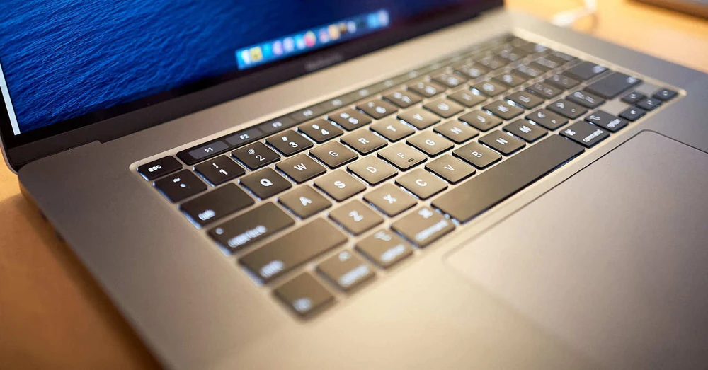
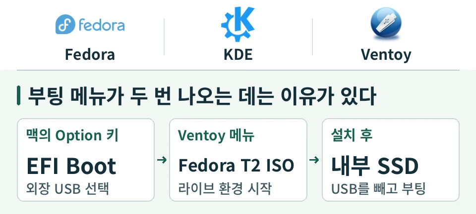
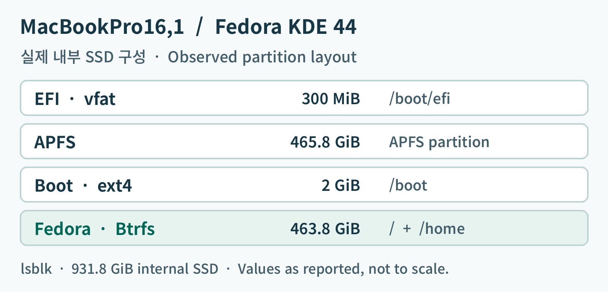

# 인텔 T2 맥북에 Fedora KDE 설치하기: Ventoy USB와 EFI 부팅 복구

[Read in English](../English/1.%20Fedora%20KDE%20installation%20and%20EFI%20boot%20recovery.md) · [시리즈 목차](../index.md)

Ventoy USB로 Fedora KDE를 설치했는데, 맥북의 내부 SSD에서는 Fedora가 부팅되지 않았다. 11월 4일 부팅 기록이 가리킨 곳은 USB가 아니라 **300MiB짜리 내부 EFI 시스템 파티션**이었다. 남은 공간은 168KiB였고, 맥이 실행하려던 `shimx64.efi`가 없었다.

장비는 Apple T2 칩이 들어간 **인텔 MacBookPro16,1**이다. i9-9980HK, 메모리 64GB, Radeon Pro 5500M을 갖춘 이 맥북을 집의 개발서버로 쓰기로 했다. 설치 준비는 t2linux의 안내를 따를 수 있지만, 이 기계에서 무슨 일이 있었는지는 USB를 뺀 뒤의 기록에서 찾았다.

사진은 [Jack Baty가 촬영한 2019년형 16인치 맥북 프로](https://commons.wikimedia.org/wiki/File:2019_16-inch_MacBook_Pro_%2849183242933%29.jpg)다([CC BY-SA 2.0](https://creativecommons.org/licenses/by-sa/2.0/), 크기·형식 변경). 아래 설치와 복구를 기록한 내 장비의 사진은 아니다.

## USB를 만들기 전에 정할 것

1. **macOS와 복구 환경을 남길지 정한다.** 이 장비에는 APFS 파티션이 남아 있다. 공존 설치라면 중요한 파일을 백업한 뒤 macOS 디스크 유틸리티에서 Linux용 **파티션**을 따로 확보한다. 같은 APFS 컨테이너 안에 볼륨만 하나 더 만드는 것과 다르다. 새 파티션의 이름과 크기를 적어 둬야 Fedora 설치 화면에서 구별할 수 있다.
2. **Ventoy USB에 Fedora ISO를 넣는다.** [Ventoy](https://www.ventoy.net/en/doc_start.html)는 USB에 한 번 설치해 두는 부팅 도구다. 처음 설치하면 대상 USB가 포맷되므로 외장 USB의 이름과 용량을 확인하고 필요한 파일은 먼저 옮겨 둔다. Ventoy 설치가 끝나면 [T2용 Fedora ISO](https://github.com/t2linux/fedora-iso/releases)를 USB의 큰 데이터 파티션에 **`.iso` 파일 그대로 복사**한다. 압축을 풀거나 Fedora 이미지로 USB 전체를 다시 덮어쓰지 않는다. 부팅할 때 어떤 ISO를 열지는 Ventoy 메뉴에서 고른다.
3. **외장 매체 부팅을 준비한다.** [t2linux 사전 설치 안내](https://wiki.t2linux.org/guides/preinstall/)의 T2 Mac 절차는 `⌘R`로 macOS 복구에 들어가 시동 보안 유틸리티에서 Linux 부팅에 맞게 Secure Boot를 **No Security**, 외장/이동식 매체 부팅을 **허용**으로 선택하는 것이다. 부팅 보안 정책을 낮추는 선택이다. 내부 디스크 설치가 끝나면 외장 매체 허용을 계속 둘지 다시 결정할 수 있다.

## Ventoy USB로 부팅하기: Mac에서는 장치, Ventoy에서는 ISO 선택

*그림: 0plan · [Fedora·KDE·Ventoy 표식 출처](../index.md#image-credits)*

USB에서 시작할 때는 **서로 다른 두 메뉴**를 지난다. `⌥ Option`을 누른 채 Mac을 켜면 시동 관리자가 뜬다. 여기서는 외장 USB의 **EFI Boot** 항목을 고른다. 그다음에 뜨는 **Ventoy 메뉴에서 Fedora ISO**를 골라야 비로소 라이브 환경으로 넘어간다. Mac은 *부팅할 장치*를 고르고, Ventoy는 *그 안에서 실행할 파일*을 고른다.

실제로 내 Ventoy USB에는 일반 Fedora KDE와 T2용 Fedora KDE가 **둘 다** 있었다. 이 맥북에 쓴 T2용 파일명은 `Fedora-t2linux-KDE-Desktop-Live-44.0.x86_64.iso`였다. 시동 관리자에 USB가 안 보이는 경우와 Ventoy 안에서 원하는 ISO를 못 찾는 경우는 이 단계에서 갈린다.

## 라이브 환경이 뜬 뒤, 내부 SSD에 설치하기

라이브 화면과 입력이 동작하면 [t2linux의 Fedora 설치 안내](https://wiki.t2linux.org/distributions/fedora/installation/)에 따라 설치 프로그램에서 내부 SSD와 아까 마련한 공간을 크기로 다시 확인한다. 공존 설치에서 회수할 공간은 **Linux용으로 만든 파티션뿐**이다. 기존 APFS나 EFI 파티션을 지우는 ‘디스크 전체 사용’과 혼동하면 안 된다. 기존 EFI 시스템 파티션은 포맷하지 않고 `/boot/efi`로 사용한다. 설치가 끝나면 USB를 빼고 재시작해 내부 디스크의 Fedora 부팅 항목을 선택한다. 와이파이가 동작하지 않으면 재설치부터 하기보다 [T2 무선 펌웨어 안내](https://wiki.t2linux.org/guides/wifi-bluetooth/)에서 해당 모델의 펌웨어를 확보하는 경로를 확인한다.

## USB를 빼니 Fedora가 부팅되지 않았다: `shimx64.efi`는 어디 있었나?

macOS에서 내부 EFI(`disk0s1`)를 읽기 전용으로 열고, `BOOT-2.LOG`와 `BOOT-8.LOG`에 적힌 부팅 대상이 그 파티션과 일치하는지 대조했다. 두 로그 모두 `\EFI\fedora\shimx64.efi`를 가리켰다. 그런데 해당 디렉터리에는 `shimx64.efi`뿐 아니라 `grubx64.efi`, `mmx64.efi`도 없었다.

이 맥북에는 이름이 비슷한 부팅 파티션이 둘 있다. **거의 찬 곳은 Fedora의 2GiB `/boot`가 아니라 Apple과 Fedora가 함께 쓰는 300MiB `/boot/efi`였다.** 당시 측정한 여유 공간은 172,032바이트(168KiB), `EFI/APPLE/CACHES`가 차지한 공간은 약 290MiB였다. T2 ISO에서 확인한 세 파일은 합쳐서 약 5.77MiB다. 남은 공간에는 들어가지 않는다. 여기까지는 실측이지만, 설치 프로그램이 그 이유로 복사를 중단했다는 오류 로그까지 확보한 것은 아니다.

EFI에 있던 파일 49개를 백업하고 해시를 확인한 뒤, 이 기계에서 확인한 Apple 캐시 파일만 정리했다. 내부 EFI에 없던 세 파일을 T2 ISO에서 복사하고 SHA-256이 ISO의 원본과 같은지 대조했다. 복구 직후 EFI 여유 공간은 **283.39MiB**였고, 같은 날 **macOS와 내부 SSD의 Fedora가 모두 부팅되는 것**을 직접 확인했다. 파티션을 키우거나 Fedora를 다시 설치할 필요는 없었다. 부팅 후 외부 화면이 깨진 일은 [다음 편의 그래픽 문제](2.%20Radeon%20외부%20화면%20멈춤.md)였다.

## 이 맥북에는 무엇이 설치됐나?

| 확인한 곳 | 이 장비의 값 |
|---|---|
| OS와 실행 커널 | Fedora Linux 44 KDE Plasma Desktop Edition · `7.2.9-310.t2.fc44.x86_64` (후속 GPU 수정 시점의 커널) |
| 내부 SSD | 931.8GiB, 그중 APFS 파티션 465.8GiB |
| 부팅 영역 | `/boot/efi`: 300MiB, vfat · `/boot`: 2GiB, ext4 |
| Fedora 데이터 영역 | 463.8GiB Btrfs, `/`와 `/home`이 같은 파티션을 사용 |

이 크기는 따라 입력할 권장값이 아니다. Fedora에서는 `lsblk -o NAME,SIZE,FSTYPE,MOUNTPOINTS`로 파티션 크기를, `df -h /boot/efi /boot`로 **각 파일시스템의 남은 공간**을 확인할 수 있다. 같은 ‘부팅 공간’이라도 어느 줄을 보느냐에 따라 답이 달라진다.

## 다음에 읽으면 좋은 글

[Fedora‑T2 ② | 부팅은 됐는데 외부 화면은 왜 멎었을까?](2.%20Radeon%20외부%20화면%20멈춤.md) — 내부 SSD에서 Fedora를 시작하는 데는 성공했다. 다음 단서는 EFI 파일이 아니라 그래픽 드라이버의 로그에 있었다.
