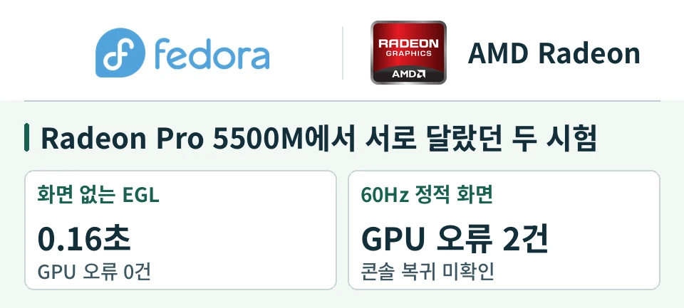

# Fedora‑T2 ② | 부팅은 됐는데 외부 화면은 왜 멎었을까?

[Read in English](../English/2.%20Radeon%20external%20display%20stalls.md) · [시리즈 목차](../index.md)

이 맥북에서는 ‘화면이 안 된다’는 말로는 고장 위치를 정할 수 없었다. 내장 패널이 물리적으로 분리돼 있고, Radeon Pro 5500M을 통해 외부 화면을 써야 했다. Fedora가 부팅되는지, GPU가 화면 없이 계산할 수 있는지, 실제 디스플레이에 출력을 유지하는지는 각각 다른 시험이다.

*그림: 0plan · [Fedora·AMD Radeon 표식 출처](../index.md#image-credits)*

두 결과는 같은 날 같은 GPU에서 나왔다. 왼쪽 시험에는 처음부터 **외부 모니터를 계속 갱신하는 단계**가 없다.

## 성공한 짧은 시험 바로 옆에 실패한 시험을 뒀다

11월 5일 진단 기록에는 화면 없이 동작하는 EGL 시험이 **0.16초, 오류 0건**으로 끝난 결과가 있다. 1080p 60Hz의 한 출력 시험도 **10.44초, 오류 0건**이었다. 그것으로 ‘그래픽 정상’이라고 적었다면 그날의 결론은 틀렸을 것이다. 별도의 60Hz 정적 화면 시험에서는 모드가 설정됐는데도 GPU 오류 2건이 나고 콘솔 복귀를 확인하지 못했다. 화면 버퍼를 교체하는 시험에서도 모드는 잡혔지만 교체 완료는 확인되지 않았고 오류 3건이 기록됐다.

| 시험이 통과한 지점 | 아직 알 수 없는 것 |
|---|---|
| 화면 없이 EGL 작업 완료 | 외부 출력의 모드 전환·화면 갱신이 안정적인가 |
| 60Hz 모드를 설정함 | 실제 프레임 교체와 콘솔 복귀가 되는가 |
| 수정한 부팅 항목에서 KDE 사용 | 나중에 추가 설치한 다른 커널에도 수정이 들어 있는가 |

## 이 장비에서 선택한 설정

진단 중에는 GPU 메모리 클럭(UCLK)을 수동으로 496MHz에 고정해 보기도 했지만, 전원·클럭을 관리하는 SMU 오류가 계속됐다. 유지한 방식은 고정 클럭이 아니다. **이 GPU의 VBIOS에 기록된 값인 95·496·598·736MHz를 드라이버가 사용하게 하고 성능 정책은 `auto`로 둔 것**이다. 여기에 디스플레이 파이프 분할을 우회하는 설정과, 실제로 분리된 내장 패널을 비활성화하는 설정을 조합했다. 내장 화면이 멀쩡한 다른 맥북에 그대로 적용할 처방은 아니다.

수정 모듈과 초기 부팅 이미지를 별도 부팅 항목에 두고 원래 항목도 남겼다. 덕분에 ‘설치된 최신 커널’과 ‘이 GPU 조합에서 확인한 커널’을 구분할 수 있었다. 나중에 KDE를 원격으로 열어 메뉴를 누르고 글자를 입력하는 동안 새 GPU 오류는 관측되지 않았다. 그 시기의 기록에는 설정을 저장한 뒤의 재부팅 시험이 보류됐다는 사실도 남아 있다. 화면 하나가 떴다는 이유로 다음 커널 업데이트까지 검증된 셈 치지 않았다.

## 다음에 읽으면 좋은 글

[Fedora‑T2 ③ | SSH로 작업 중인데 맥북은 왜 15분 만에 잠들었을까?](3.%20SSH%20작업%20중%20자동%20절전.md) — 원격에서 보면 절전도 고장처럼 보였다. 다시 연결했을 때 부팅 세션이 그대로였다는 기록이 둘을 가르는 단서였다.
