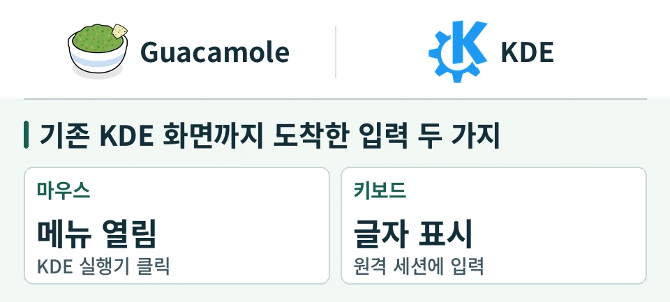

# Fedora‑T2 ④ | 원격 데스크톱에 연결했는데 잠금 배경만 보였다

[Read in English](../English/4.%20KDE%20remote%20desktop%20lock%20screen.md) · [시리즈 목차](../index.md)

브라우저에 KDE의 잠금 배경이 떴다. 네트워크와 화면 전송은 적어도 무언가를 전달하고 있었다. 하지만 내가 하려던 일은 배경화면을 보는 게 아니라, 자리에 없는 맥북에서 **기존 세션의 메뉴를 열고 글자를 입력하는 것**이었다.

이때의 구성은 브라우저가 웹 원격 데스크톱 게이트웨이인 Guacamole에 접속하고, 게이트웨이는 맥북의 KRDP를 통해 KDE 세션을 보여 주는 방식이었다. 나중에 터미널만 필요해 기본 부팅을 바꾼 개발서버 구성과는 시점이 다르다. 이 시험에는 로그인해 있는 KDE 세션이 필요했다.

*그림: 0plan · [Guacamole·KDE 표식 출처](../index.md#image-credits)*

그림은 **사설 터널에서 확인한 동작**을 정리한 것이다. 브라우저에 잠금 배경 한 장이 뜬 시점에는 아직 양쪽 모두 확인되지 않았다.

## 무엇을 공유하고 있었나

기존 `SharedAccess` 모드에서는 로컬 KDE가 잠기면 원격으로도 잠금 배경만 보였다. 이것을 네트워크 시간 초과로 취급해서는 해결할 수 없다. 실제 사용 목적에 맞는 `RemoteAccess` 모드에서는 인증한 원격 사용자가 기존 세션을 가상 모니터에서 사용하고, 로컬 화면은 로그인 화면으로 전환됐다. 연결을 끊고 나서는 세션이 다시 잠긴 상태임도 확인했다. 자리를 비운 컴퓨터의 화면을 계속 열어 둘 필요가 없었다.

## 화면 한 장 대신 두 가지 입력을 시험했다

사설 SSH 터널을 통한 브라우저 시험에서 KDE 메뉴를 마우스로 열고, 시험 문자열을 키보드로 입력해 그 글자가 **원격 화면에 되돌아오는 것**을 봤다. WebSocket 프레임 217개와 브라우저 콘솔 오류 0건도 기록에 있다. 하지만 프레임 수보다 설득력 있는 결과는 내가 누른 메뉴가 열리고 내가 친 글자가 보였다는 것이다. 아무 동작 없이도 화면 갱신 프레임은 오갈 수 있기 때문이다.

이 수치는 사설 터널 시험의 결과다. 로그인 전 공개 주소가 인증 화면으로 보내는 것과, 로그인 후 공개 경로를 거친 모든 입력이 통하는 것도 구분해서 기록했다. 나중에 ‘원격 접속 정상’이라는 한 줄을 볼 때 **어느 경로에서, 무슨 화면을 보았고, 무엇을 직접 해 봤는가**를 되짚을 수 있다.

## 다음에 읽으면 좋은 글

[Fedora‑T2 ⑤ | 맥북에 세 번째 팬이 없는데 Fedora는 왜 Fan3를 찾았을까?](5.%20두%20팬과%20Fan3%20오류.md) — 이번에 확인한 건 키 입력이었다. 팬 제어 서비스를 고친 뒤에는 화면의 ‘실행 중’ 대신 팬 두 개의 회전수를 확인했다.
