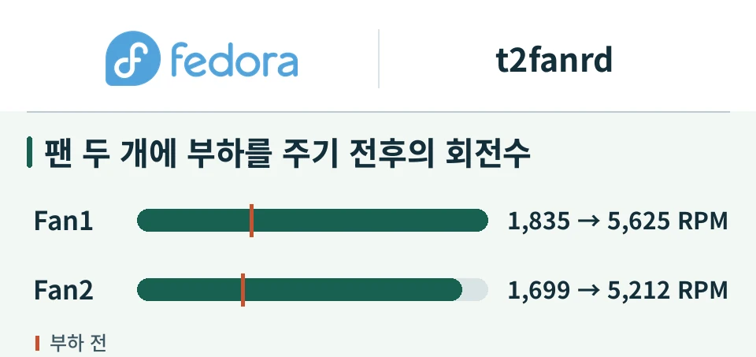

# Fedora‑T2 ⑤ | 맥북에 세 번째 팬이 없는데, Fedora는 왜 Fan3를 찾았을까?

[Read in English](../English/5.%20Fan3%20on%20a%20two-fan%20Mac.md) · [시리즈 목차](../index.md)

인텔 맥북 프로를 Fedora 개발서버로 바꾸던 중 팬 제어 서비스가 멈췄다. 로그를 읽으면 해결책까지 친절하게 알려 주는 듯했다. `Missing Fan3 in config file`. 그렇다면 설정 파일에 세 번째 팬을 추가하면 될까?

바로 전까지 같은 설정으로 돌던 장비였다. 11월 13일 00:36에 팬 제어 패키지가 설치됐고, 00:37에 기존 프로세스가 종료된 뒤 새 프로세스가 뜨지 않았다. 재시작 횟수는 다섯 번이었다. 설정을 고치기 전에 **왜 프로그램이 어제와 다른 수의 팬을 기대하는지**부터 볼 이유가 있었다.

*그림: 0plan · [Fedora 표식 출처](../index.md#image-credits)*

짧은 주황색 선은 부하를 주기 전, 초록 막대의 끝은 부하를 준 뒤의 회전수다. 설정에서 빠진 세 번째 막대는 없다.

## 장치 이름 끝의 한 글자

팬 제어 프로그램은 리눅스의 하드웨어 모니터링 인터페이스를 읽어 장치를 구분한다. 여기에는 노트북의 냉각 팬 외에 AMD GPU의 항목도 보였다. 프로그램은 `amdgpu`라는 이름을 만나면 빼도록 만들어져 있었다. 그런데 실제 파일을 읽은 문자열은 `"amdgpu\n"`이었다. 화면에 한 줄로 출력하면 같은 이름처럼 보이지만 끝에 줄바꿈이 한 글자 붙는다.

설치된 `t2fanrd` 0.1.2-1은 그 줄바꿈을 떼지 않고 `"amdgpu"`와 비교했다. GPU 항목이 제외되지 않았고 프로그램은 Fan3 설정이 더 필요하다고 판단했다. 설정이 빠졌다는 오류는 **장치를 잘못 센 뒤에** 나온 말이었다. 업스트림은 이름 양끝의 공백을 정리해 0.1.2-2로 빌드했다. 처음에는 패키지 관리자가 `Nothing to do`라고 했지만 메타데이터를 갱신하자 수정 빌드가 보였다. 업데이트 전후 설정 파일의 해시는 같았다.

## 서비스가 켜지는 것과 팬이 도는 것은 다르다

업데이트 뒤 서비스는 재시작 없이 활성 상태를 유지했고 Fan3 오류도 사라졌다. 마지막으로 부하를 주고 **팬의 실제 회전수**를 봤다.

| 관측한 팬 | 부하 전 | 부하 중 |
|---|---:|---:|
| Fan1 | 1,835 RPM | 5,625 RPM |
| Fan2 | 1,699 RPM | 5,212 RPM |

부하를 거두자 회전수도 다시 내려왔다. 이 짧은 시험의 최고 온도는 54°C였다. 다른 맥북에도 이 온도나 회전수를 맞추라는 뜻은 아니다. 이 장비에서 확인할 것은 **부하에 두 팬이 반응하고, 원인이 사라지면 제어가 다시 돌아오는가**였다. 가상의 세 번째 팬을 설정에 더했다면 오류 메시지는 달라졌을지 몰라도 이 질문에는 답하지 못했을 것이다.

## 다음에 읽으면 좋은 글

[Fedora‑T2 ③ | SSH로 작업 중인데 맥북은 왜 15분 만에 잠들었을까?](3.%20SSH%20작업%20중%20자동%20절전.md) — 부하를 주면 두 팬이 반응했다. 사람이 곁에 없는 서버로 쓰려면 질문이 하나 더 남는다. 덮개를 닫은 뒤에도 SSH로 작업을 이어 갈 수 있을까?
