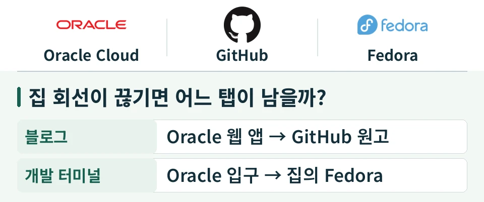

# 집에 서버가 있는데, 0plan은 Oracle Cloud를 어디에 쓸까?

집 밖에서 브라우저 탭 두 개를 연다. 한쪽에서는 0plan의 NAS 구성기를 읽고, 다른 쪽에서는 집에 있는 맥북의 개발 터미널을 연다. 여기서 집 인터넷이 끊긴다면 어떤 탭을 계속 쓸 수 있을까?

Oracle Cloud와 GitHub가 정상이라면 블로그에서는 다음 글도 열 수 있다. 반면 집 밖에서는 맥북에 새 명령을 보낼 수 없다. **블로그 탭에서 Oracle은 웹 서버이고, 터미널 탭에서는 집으로 들어가는 입구다.**

그림에서 **집으로 들어가는 화살표**는 아랫줄에만 있다. 집 회선을 빼고 생각해 보면 Oracle에 둔 두 역할이 분명해진다.

## 1. 지금 이 글을 보여 주는 곳

0plan 블로그의 원고는 GitHub에 Markdown 파일로 보관한다. 독자가 `www.0plan.dev`에서 글을 열면, 그 원고를 읽어 제목과 목차, 본문이 있는 페이지로 보여 주는 것은 Oracle의 ARM64 가상 서버에서 실행 중인 0plan 웹 앱이다. 같은 장비에서는 공매 데이터를 제공하는 API도 별도 컨테이너로 돌아간다.

여기서 NAS의 역할은 없다. 집에서 디스크를 점검한다고 해서 블로그 본문을 가져오는 경로가 끊기지는 않는다. 반대로 GitHub에서 글을 읽을 수 없는 문제라면, 집의 NAS를 재부팅해도 해결되지 않는다. **글을 보관하는 곳은 GitHub, 독자에게 페이지를 제공하는 곳은 Oracle**이라는 구분이 장애를 살펴볼 때도 쓸모 있다.

## 2. 집에 있는 터미널을 여는 입구

개발용 주소로 접속해 터미널에 `git status`를 입력하면, 작업 디렉터리를 읽는 장비는 집에 있는 Fedora 맥북이다. 명령을 실행하려고 소스 코드를 Oracle에 한 벌 더 둘 필요는 없다. Oracle은 접속 권한을 확인하고, 맥북이 연결해 둔 터널로 요청을 넘겨준다. 명령의 결과도 그 길을 따라 내 브라우저에 돌아온다.

그래서 개발용 주소에 로그인 화면이 뜨는 것과 터미널에서 명령이 돌아가는 것은 서로 다른 증거다. 전자는 Oracle의 입구까지 도착했다는 뜻이고, 후자는 집까지 다녀왔다는 뜻이다.

## 집과 클라우드를 나누고 나서

집의 저장장치를 손보는 동안에도 블로그는 Oracle에서 글을 보여 준다. 개발 장비를 바꿔도 터널을 새 장비로 연결하면 브라우저에 입력하는 주소는 그대로다. 반대로 Oracle 인스턴스가 멈추면 집의 맥북이 멀쩡해도 밖에서 터미널에 들어갈 수 없고, 블로그도 열리지 않는다. 두 탭이 어디까지 같은 길을 쓰는지 알면, 하나만 안 열릴 때와 둘 다 안 열릴 때 어디부터 확인할지 달라진다.

*[그림 출처 및 이용 조건](https://raw.githubusercontent.com/0plan/blog/483cbd2a01d481c65a92f36ec805558f8858debf/assets/images/article-figures/credits.txt)*

## 다음에 읽으면 좋은 글

[Oracle Cloud와 우리 집 홈서버는 어떻게 연결되어 있을까?](Oracle%20Cloud%EC%99%80%20%ED%99%88%EC%84%9C%EB%B2%84%EB%A5%BC%20%EC%97%B0%EA%B2%B0%ED%95%98%EB%8A%94%20%ED%84%B0%EB%84%90.md) — 위 그림에서 화살표 하나로 지나친 것이 `터널`이다. 누가 먼저 그 길을 열었고, 서버를 맥북으로 옮기고도 어떻게 같은 주소를 썼는지 따라간다.

[홈서버 재구성 ① | Proxmox에 NAS VM 만들기](https://www.0plan.dev/blog/홈서버%20재구성/1.%20Proxmox에%20NAS%20VM%20만들기.md) — 클라우드로 옮기지 않고 집에 남겨 둔 쪽이 궁금하다면, 파일 하나가 실제로 어느 디스크에 저장되는지부터 볼 수 있다.
