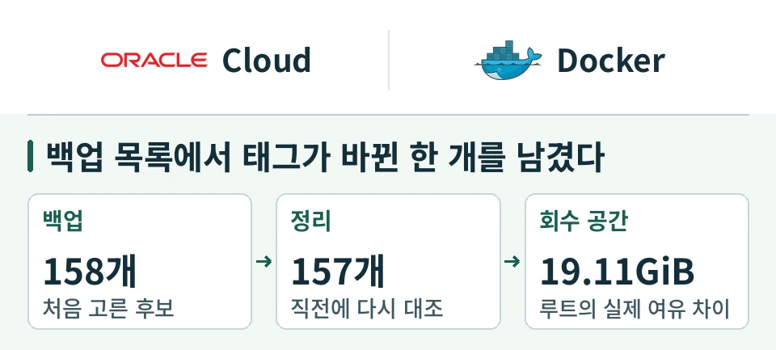

# Oracle 서버에서 Docker 이미지 158개를 골라 놓고 157개만 지운 이유

Oracle 서버의 루트 파일시스템은 192.69GiB였다. 2026년 11월 25일, 컨테이너가 참조하지 않는 이미지 레이어를 세어 보니 22.50GiB였다. 지울 후보는 찾았다. 그런데 운영 서버에서 정말 궁금했던 숫자는 따로 있었다. **지금 쓰는 서비스를 그대로 두면서, 실제 디스크에서 몇 GiB를 돌려받을 수 있을까?**

가운데에서 빠진 하나는 백업에 실패한 이미지가 아니다. **다시 확인하는 사이 태그가 바뀌어 남긴 이미지**다.

## 이미지 목록의 합계와 디스크 여유는 다른 숫자다

Docker 이미지는 여러 레이어를 겹쳐 만든다. 예전 웹 앱 이미지와 새 이미지가 같은 기반 레이어를 쓴다면, 예전 이미지를 지워도 그 레이어는 남아야 한다. 이미지 열 개의 `SIZE`를 더한 값이 곧 지울 수 있는 용량은 아니다.

그래서 측정 기준을 둘로 나눴다. **무엇이 차지하는지** 살필 때는 Docker의 레이어와 컨테이너 참조를 봤고, **얼마나 비웠는지** 판정할 때는 정리 직전과 직후에 같은 파일시스템의 `df` 값을 비교했다. 자기 서버에서 먼저 살펴보려면 `docker system df -v`의 공유 용량과 고유 용량을 구분해 보고, 별도로 `df -h /`에서 루트 디스크의 여유를 보면 된다.

## ‘안 쓰는 이미지’라는 판정에는 유효 시간이 있다

먼저 후보 158개의 이미지와 태그 정보를 기록하고, 압축 아카이브 일곱 묶음을 NAS에 보관했다. 합계 10.83GiB였다. NAS에서 각 이미지의 설정과 태그, 레이어가 아카이브에 있는지 확인하고, 한 개는 별도 환경에서 실제로 복원했다. 외부 저장소에 보낸 아카이브도 다시 읽어 파일별 해시가 일치하는지 대조했다. **10.83GiB는 압축한 보관본 크기**다. 운영 디스크에서 회수할 공간을 뜻하지 않는다.

여기서 바로 처음 만든 목록을 지우지 않았다. 그 사이 누군가 새 이미지를 빌드하거나 태그를 옮길 수 있어서다. 삭제 직전에 컨테이너가 쓰는 이미지와 태그를 다시 대조하니, 실제로 **후보 한 개의 태그가 바뀌어 있었다.** 바뀐 이유를 짐작해서 지우기보다 그 한 개를 남겼다. 158개를 백업하고도 157개만 지운 이유다.

## 결과는 같은 디스크에서 다시 쟀다

| Oracle 서버에서 확인한 값 | 정리 직전 | 정리 직후 |
|---|---:|---:|
| 로컬 이미지 ID 수 | 250개 | 93개 |
| 루트 파일시스템 여유 | 45.21GiB | 64.32GiB |
| 루트 파일시스템 사용률 | 77% | 67% |

회수한 공간은 **19.11GiB**였다. 컨테이너 86개 중 실행 중인 것은 80개였고, 정리 전후 각 컨테이너의 상태와 사용 이미지 ID는 같았다.

이번에 남겨 두고 싶은 기준은 두 가지다. 다음에 용량이 부족해지면 **후보를 정한 때와 삭제하는 때 사이에 무엇이 바뀌었는지**부터 보겠다. 그리고 정리 결과에는 Docker가 보여 준 추정치 대신, 정리 전후의 실제 여유 공간을 적겠다. 둘을 구분해야 남은 디스크로 다음 빌드를 감당할 수 있을지 판단할 수 있다.

*[그림 출처 및 이용 조건](https://raw.githubusercontent.com/0plan/blog/483cbd2a01d481c65a92f36ec805558f8858debf/assets/images/article-figures/credits.txt)*

## 다음에 읽으면 좋은 글

- [오라클 클라우드 Ubuntu 디스크 용량 확장하기](https://www.0plan.dev/blog/오라클%20클라우드%28OCI%29/오라클%20클라우드%20디스크%20용량%20확장하기.md) — 정리해도 공간이 모자랄 때, OCI에서 늘린 용량이 Ubuntu의 `df`에도 보이도록 파티션과 파일시스템을 확장하는 과정이다.
- [NAS의 30일 지난 백업, 언제 지워도 될까?](../%ED%99%88%EC%84%9C%EB%B2%84%20%EC%9E%AC%EA%B5%AC%EC%84%B1/NAS%EC%99%80%20%EB%B0%B1%EC%97%85/NAS%EC%9D%98%2030%EC%9D%BC%20%EC%A7%80%EB%82%9C%20%EB%B0%B1%EC%97%85%EC%9D%84%20%EC%A7%80%EC%9A%B0%EB%8A%94%20%EA%B8%B0%EC%A4%80.md) — 이번에는 이미지 태그 대신 백업 파일이 바뀌는 경우다. 외부 사본을 확인한 뒤에도 NAS 파일을 한 번 더 살펴본 이유를 다룬다.
