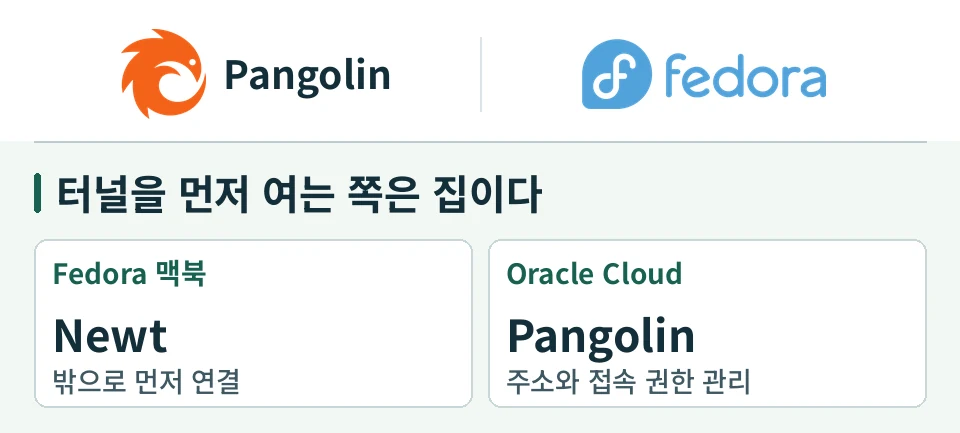
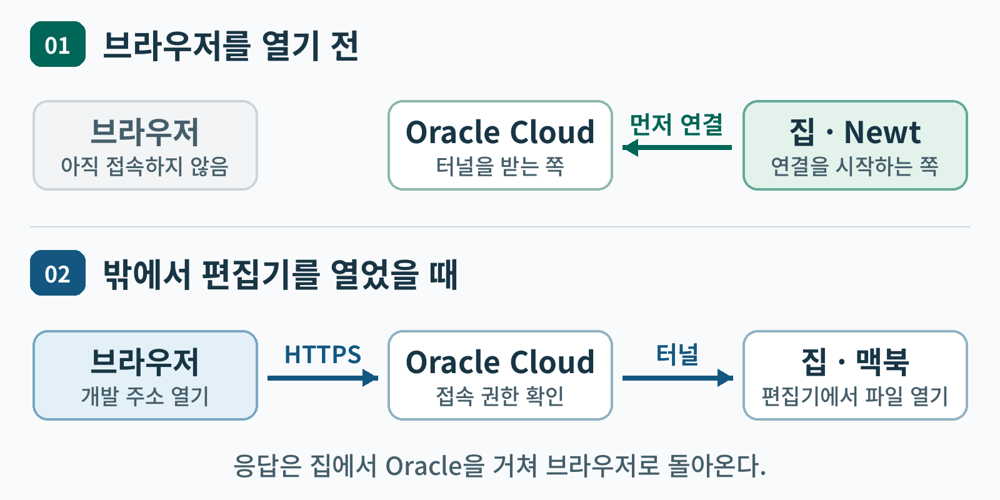

# Oracle Cloud와 우리 집 홈서버는 어떻게 연결되어 있을까?

집 밖에서 평소 쓰던 개발용 주소를 열면 집에 있는 맥북의 터미널이 뜬다. 그런데 그 주소가 가리키는 곳은 우리 집이 아니라 Oracle Cloud다. 집 공유기에도 개발서버로 들어오는 포트포워딩 규칙은 없다. 그렇다면 Oracle은 어떻게 우리 집을 찾아올까?

**먼저 연결하는 쪽은 집이다.** 내가 주소창에 주소를 입력하기 전부터, 집 안의 프로그램이 Oracle에 연결해 길을 만들어 둔다. 브라우저에서 보낸 요청은 나중에 그 길을 반대 방향으로 이용한다.

## 1. 브라우저를 열기 전: 집에서 길을 만든다

집에서 쓰는 프로그램의 이름은 **Newt**다. 개발서버인 Fedora 맥북에서 Newt가 Oracle에 둔 **Pangolin**에 접속한다. Pangolin은 어느 장소에 어떤 서비스가 있고 누가 접속할 수 있는지 관리한다. [Pangolin 공식 문서](https://docs.pangolin.net/about/how-pangolin-works)에서는 Newt처럼 그 장소의 네트워크를 연결해 주는 프로그램을 *사이트 커넥터*라고 부른다. Newt는 Pangolin에서 받은 정보로 Oracle 쪽과 **WireGuard 터널**, 즉 두 장비 사이에서 데이터를 암호화해 주고받는 통로를 만든다.

포트포워딩을 썼다면 바깥에서 집 공유기로 들어오는 새 연결을 어느 장비에 넘길지 정해 줘야 한다. 여기서는 집이 먼저 바깥과 통신을 시작한다. Oracle이 나중에 요청을 전달할 때도 집 인터넷 주소로 새 연결을 거는 대신, Newt가 유지하고 있는 터널을 쓴다. 이 터널이 있다고 해서 집 안의 모든 장비가 공개되는 것도 아니다. 개발용 주소로 들어온 요청을 어떤 서비스에 보낼지는 따로 지정한다.

## 2. 주소를 열었을 때: 요청 하나를 따라가 보자

예를 들어 집 밖에서 브라우저용 코드 편집기인 **code-server**를 연다고 해 보자.

1. **브라우저 → Oracle.** DNS가 개발용 도메인 이름을 공개 접속 주소로 바꿔 준다. 브라우저가 그 주소로 HTTPS 요청을 보내면 Oracle의 **Traefik**이 받는다. Traefik은 요청을 대신 받아 목적지로 전달하는 리버스 프록시다. 이 편집기에는 Pangolin의 로그인 정책이 걸려 있어, 권한이 확인돼야 요청이 다음 구간으로 넘어간다.
2. **Oracle → 집.** 인증을 통과한 요청은 이 도메인에 지정한 Fedora 쪽 터널로 들어간다. 집의 Newt가 요청을 받아 맥북에서 실행 중인 code-server에 전달한다. 터널의 양 끝은 **Oracle과 집**이다. 그래서 밖에서 쓰는 기기에는 Newt를 설치할 필요가 없다.
3. **집 → 내 화면.** 편집기에서 프로젝트 파일을 열면 파일을 읽는 곳은 맥북이다. 응답은 터널과 Oracle을 거쳐 브라우저로 돌아온다. 브라우저에 보이는 주소는 처음 입력한 그대로다.

여기서 로그인과 터널은 서로 다른 일을 한다. **로그인은 내가 들어가도 되는지 판단하고, 터널은 허용된 요청을 집까지 나른다.** 그래서 맥북의 편집기가 멈춘 상황에서도 Oracle의 로그인 화면은 정상적으로 뜰 수 있다.

## 3. 그러면 서버를 옮길 때 무엇이 바뀔까?

이 구분이 가장 유용했던 때는 Herdr와 code-server를 Proxmox의 개발 컨테이너에서 Fedora 맥북으로 옮길 때였다. 브라우저에 저장된 주소를 바꾸는 대신, 맥북에 별도의 Newt를 두고 시험용 주소를 먼저 연결했다. 시험 주소에서 로그인한 뒤 실제로 터미널을 열고 다시 접속했고, 편집기에서 파일을 열고 저장했다. 로그인 화면만 확인했다면 새 맥북까지 요청이 도달했는지는 알 수 없었을 것이다.

그다음 **기존 도메인의 DNS와 로그인 설정은 그대로 두고, Oracle이 요청을 넘길 대상만 맥북 쪽으로 바꿨다.** 전환 뒤에는 기존 도메인 설정으로 두 서비스의 실시간 연결(WebSocket)을 검사했다. 둘 다 연결 방식 전환을 뜻하는 `101`로 응답했고, Herdr에서는 그 연결로 실제 데이터도 돌아왔다. 브라우저가 찾아오는 곳은 전과 같은데, 명령을 실행하는 장비와 거기까지 가는 터널이 달라진 것이다.

처음 질문으로 돌아가 보자. Oracle은 바뀐 우리 집 IP를 찾아다니지 않는다. **집에서 Oracle로 연결하고, 밖에서는 Oracle로 접속한다.** 두 연결이 만나는 곳이 같아서, 집에 있는 서버를 바꿔도 내가 기억할 주소는 하나로 남았다.

*[그림 출처 및 이용 조건](https://raw.githubusercontent.com/0plan/blog/483cbd2a01d481c65a92f36ec805558f8858debf/assets/images/article-figures/credits.txt)*

## 다음에 읽으면 좋은 글

- [집에 서버가 있는데, 0plan은 Oracle Cloud를 어디에 쓸까?](0plan%EC%97%90%EC%84%9C%20Oracle%20Cloud%EC%9D%98%20%EC%97%AD%ED%95%A0.md) — 지금 읽고 있는 블로그 글도 같은 터널을 지날까? 클라우드에서 끝나는 요청과 집으로 이어지는 요청을 비교한다.
- [홈서버 재구성 ②: 개발서버 분리하기](../%ED%99%88%EC%84%9C%EB%B2%84%20%EC%9E%AC%EA%B5%AC%EC%84%B1/2.%20%EA%B0%9C%EB%B0%9C%EC%84%9C%EB%B2%84%20%EB%B6%84%EB%A6%AC%ED%95%98%EA%B8%B0.md) — 연결을 바꾼 날 맥북으로 함께 옮긴 것은 무엇이고, 어제 하던 작업을 이어갈 수 있는지는 어떻게 확인했을까?
