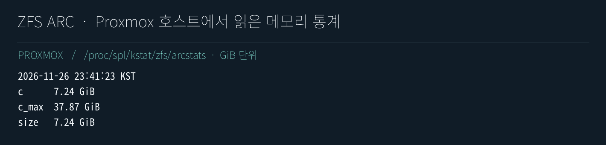
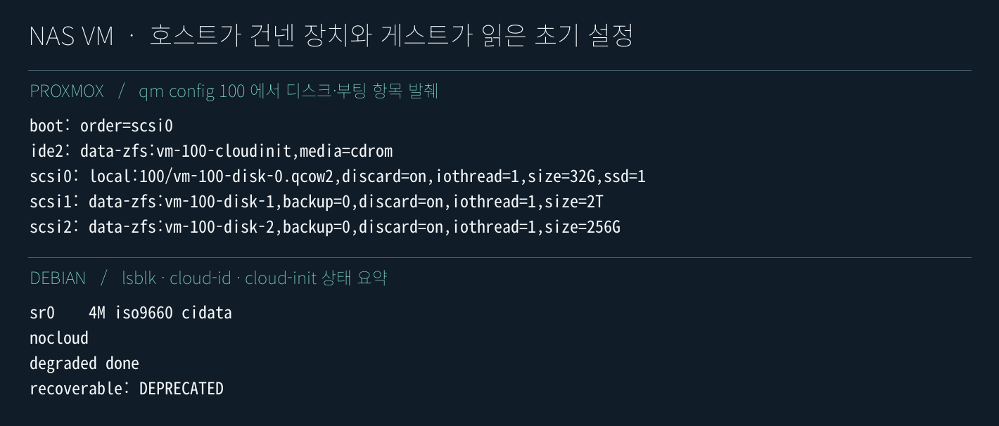

# 홈서버 재구성 ① | Proxmox에 NAS VM 만들기: SSD에 OS를, ZFS에 데이터를 둔 이유

홈서버를 다시 구성하면서 파일 공유를 Proxmox 호스트에서 떼어내 별도의 가상 머신에 맡겼다. 집 안의 PC에서 보면 여전히 네트워크 공유 폴더다. 달라진 건 그 폴더를 열었을 때 **어느 시스템이 요청을 받고, 어느 디스크에 파일을 쓰는지**다.

## NAS 한 대의 구성

집에 있는 PC에서 Proxmox를 실행하고, 그 안에 Debian 13 VM을 NAS로 구성했다.

| 자원 | 물리 PC (Proxmox 호스트) | NAS VM에 배정한 사양 |
|---|---|---|
| CPU | Intel Core i3-6100, 3.70GHz (2코어 4스레드) | vCPU 2개 |
| 메모리 | 40GB 장착 (16GB × 2 + 4GB × 2), Linux 인식 약 38.9GiB | 4GiB |

호스트의 RAM 전체를 NAS에 배정한 것은 아니다. Debian과 Samba는 VM의 4GiB 안에서 돌아가고, 아래에서 설명할 ZFS 캐시는 호스트 메모리를 쓴다. 디스크도 같은 방식으로 물리 PC가 가진 용량과 VM에 내준 용량을 구분해 보자.

| 물리 디스크(표기 용량) | Proxmox 호스트에서의 구성 | NAS와의 관계 |
|---|---|---|
| SSD 120GB | LVM 위에 ext4로 호스트 루트 구성 | `local` 저장소에 NAS 운영체제용 32GiB 가상 디스크를 `qcow2` 파일로 보관 |
| HDD 8TB | ZFS `data-pool` (약 7.27TiB) | `data-zfs`라는 이름으로 Proxmox에 등록하고, 여기서 NAS 데이터용 2TiB 가상 디스크를 할당 |
| HDD 1TB | 별도 ZFS `backup-pool` | 호스트의 `/mnt/backup`으로 사용. NAS 용량에 합치거나 8TB 디스크의 미러로 쓰지 않음 |

8TB HDD 전체를 VM에 넘긴 것은 아니다. 호스트가 물리 디스크를 관리하고, VM에는 필요한 크기의 디스크를 보여준다. 그래서 **8TB는 물리 디스크의 크기이고, 2TiB는 NAS에 할당한 가상 디스크의 크기**다. 제품 표기의 TB는 10진 단위라서 같은 8TB도 시스템에서는 약 7.27TiB로 보인다.

## ZFS를 썼는데 NAS 안에서는 왜 ext4로 보일까?

ZFS는 디스크 공간을 **풀(pool)**로 관리하고, 그 안에 파일을 담을 공간이나 가상 디스크를 만들 수 있는 파일 시스템이다. 이 구성에서 8TB HDD로 만든 풀이 `data-pool`이고, 그 풀에서 잘라 VM에 디스크처럼 건넨 2TiB 볼륨이 **zvol**이다. Debian은 이 공간을 `/dev/sdb`라는 디스크로 보고 ext4로 사용한다. ZFS와 ext4 중 하나를 고른 게 아니라, **호스트는 가상 디스크를 제공하고 게스트는 그 안에 파일을 정리하는** 역할 분담이다.

```text
Proxmox 호스트                                  NAS VM (Debian 13)
SSD 120GB ── local ── qcow2 파일 32GiB ── scsi0 ── /dev/sda1 ── ext4 ── /
HDD   8TB ── data-pool ── zvol 2TiB ──── scsi1 ── /dev/sdb  ── ext4 ── /srv/nas
HDD   1TB ── backup-pool/archive ── /mnt/backup (호스트에 마운트)
```

그림은 실제 마운트된 경로를 중심으로 그렸다. VM에는 같은 `data-pool`에서 할당한 256GiB 디스크(`scsi2`)도 연결돼 있지만, 확인 당시 게스트에서 마운트되지 않았다. `/srv/nas`에 그만큼의 공간이 더 붙는 것은 아니다.

ZFS의 장점 하나는 데이터를 읽을 때 **체크섬**으로 손상 여부를 확인할 수 있다는 점이다. 다만 이 서버의 두 풀은 **각각 HDD 한 개**로 구성돼 있다. 체크섬으로 손상을 발견해도 정상 사본이 없으면 데이터를 고칠 수 없다. 같은 풀에 만든 스냅숏도 그 디스크가 고장 나면 함께 잃는다. 따라서 별도 HDD를 달았다는 사실보다 중요한 질문은 **“거기에 어떤 데이터의 사본이 실제로 있나?”**다.

## NAS VM은 메모리가 4GiB인데, ZFS ARC는 왜 7GiB일까?

NAS에서 같은 파일을 다시 열었을 때 매번 HDD까지 읽으러 갈 필요는 없다. **ARC(Adaptive Replacement Cache)**는 ZFS가 최근에 읽었거나 자주 쓰는 데이터 블록과 메타데이터를 RAM에 보관하는 읽기 캐시다. 이 구성에서 ZFS를 실행하는 곳은 Debian 게스트가 아니라 **Proxmox 호스트**다. 따라서 ARC는 호스트의 메모리를 쓰고 여러 풀이 함께 사용한다. NAS VM에 배정한 4GiB는 게스트 OS와 서비스가 쓰는 별도의 메모리다.



11월 26일 호스트에서 `/proc/spl/kstat/zfs/arcstats`를 읽었다. `size`는 **현재 크기**, `c`는 **현재 목표 크기**, `c_max`는 **목표가 커질 수 있는 상한**이다. 이때 실제 ARC는 약 **7.24GiB**였다. `c_max`가 37.87GiB라고 해서 그만큼을 이미 차지하거나 미리 예약했다는 뜻은 아니다. ARC 목표는 부하와 메모리 압력에 따라 달라진다. 이 한 번의 측정만으로 상한을 낮춰야 한다거나 캐시 덕분에 얼마나 빨라졌다고 결론 내릴 수는 없다.

## cloud-init: 부팅 디스크 옆에 4MiB CD가 있는 이유

VM 하드웨어 목록에는 OS·데이터 디스크 외에 `ide2`라는 CD-ROM이 하나 더 있다. **cloud-init**은 새 VM의 첫 부팅 때 사용자 계정, SSH 공개키, 네트워크 같은 초기 설정을 적용하는 도구다. Proxmox는 이 VM의 설정을 작은 가상 CD에 담아 연결한다. 부팅은 32GiB OS 디스크(`scsi0`)에서 하고, Debian 안의 cloud-init이 CD에서 설정을 읽는다. 여기서 `NoCloud`는 인터넷상의 설정 서버 없이 로컬 매체에서 초기 설정을 받는 방식의 이름이다.



위 그림은 호스트와 게스트의 실제 명령 출력을 발췌한 것이다. `lsblk`에 보이는 **`sr0`, `iso9660`, `cidata`**가 그 가상 CD다. 2TiB 데이터 디스크인 `/dev/sdb`와는 역할이 다르다. 이 VM에는 초기 사용자, SSH 공개키, IP 및 DNS 설정 항목이 있다. 공유 폴더가 올바른 디스크에 연결됐는지는 cloud-init 상태가 아니라 다음 절의 마운트 검사로 확인한다.

한 가지 놓치기 쉬운 점도 있었다. 이 VM에서 `cloud-init status`는 `status: done`을 출력했지만 종료 코드는 `2`였다. `cloud-init status --format json`으로 보니 상세 상태는 `degraded done`, 복구 가능한 경고 분류는 `DEPRECATED`였다. **초기화가 끝났다는 것과 경고 없이 끝났다는 것은 다르다.**

## 디스크를 붙인 뒤에는 VM 안에서 다시 확인한다

Proxmox 관리 화면에서 `scsi1: 2T`를 확인하면, VM에 디스크를 건넨 것까지는 알 수 있다. Debian이 그 디스크를 `/srv/nas`에 연결했는지는 별개의 문제다. NAS VM 안에서 다음 명령으로 확인했다.

```console
$ findmnt --mountpoint /srv/nas --noheadings --output SOURCE,FSTYPE,TARGET
/dev/sdb ext4 /srv/nas
```

여기서 중요한 건 `--mountpoint`다. 디스크가 마운트되지 않아도 `/srv/nas`라는 디렉터리는 남을 수 있다. 그 상태에서 파일을 복사하면 2TiB 데이터 디스크가 아니라 **32GiB OS 디스크**가 찬다. `ls /srv/nas`로 폴더가 열리는지만 확인해서는 둘을 구분할 수 없다.

재부팅 때 사용할 설정도 따로 봤다.

```console
$ findmnt --fstab --mountpoint /srv/nas --noheadings --output FSTYPE,TARGET
ext4 /srv/nas
```

첫 번째 출력은 **지금 연결된 디스크**, 두 번째는 **부팅 시 연결하도록 기록한 설정**이다. 장치명 `/dev/sdb`는 이 VM에서 관찰한 값이므로 다른 NAS를 구성할 때 그대로 전제할 필요는 없다.

실제 `/etc/fstab`에서는 `/dev/sdb` 대신 파일 시스템의 **UUID**로 이 디스크를 지정했다. 가상 디스크 추가로 장치명이 달라져도 같은 ext4 파일 시스템을 찾아 `/srv/nas`에 올리기 위해서다. 그리고 디스크를 찾지 못하면? 이 NAS에서는 Samba 서비스에 `RequiresMountsFor=/srv/nas /run/samba`를 설정했다. systemd가 공유 서비스를 시작하기 전에 필요한 마운트를 먼저 올리고, 마운트에 실패하면 서비스도 시작하지 않는다. 빈 디렉터리를 정상 공유처럼 내보내지 않도록 한 장치다. 이 설정이 NAS 안의 다른 모든 쓰기 작업까지 막아주는 것은 아니다.

## 파일 공유에 Samba를 선택한 이유

기존 데스크톱은 이미 **SMB**로 공유 폴더에 접속하고 있었다. SMB는 PC와 NAS가 파일을 주고받는 규약이고, Samba는 Debian에서 그 규약으로 폴더를 공유해 주는 소프트웨어다. 공유를 Proxmox 호스트에서 NAS VM으로 옮겨도 PC에서는 익숙한 파일 관리자로 폴더를 열고 파일을 복사할 수 있다. Linux끼리는 NFS도 선택지지만, 이번 이전에서는 클라이언트의 마운트 방식까지 바꿀 이유가 없었다.

또 하나의 이유는 **같은 폴더를 열어도 할 수 있는 일은 계정별로 다르게** 두고 싶었기 때문이다. `/srv/nas` 아래의 공유는 기본 읽기 전용으로 두고, 파일을 정리하는 계정만 Samba의 `write list`에 넣었다. 이 계정도 Debian 쪽 파일·디렉터리 권한이 허용하는 범위에서만 쓸 수 있다.

이 VM에서는 데스크톱용 공유를 별도 systemd 서비스로 실행한다. 그래서 기본 `smbd.service`가 `inactive`여도 실제 공유 서비스는 `active`다. 공유 상태를 확인할 때는 앞에서 `/srv/nas` 마운트에 의존하도록 설정한 서비스를 보면 된다.

## 나누고 나서야 보인 백업의 경계

Proxmox에서 NAS VM의 하드웨어 설정을 다시 보면, 2TiB 데이터 디스크에는 `backup=0`이 붙어 있다. **이 구성에서 VM 백업이 성공했다는 말은 `/srv/nas`에 보관한 파일까지 복사됐다는 뜻이 아니다.** OS와 데이터를 나눠 관리하기로 했다면, 복구할 때도 두 대상을 따로 확인해야 한다.

이번 구성에서 남겨둘 기록은 간단하다. **공유를 제공하는 건 NAS VM, 파일이 놓이는 곳은 `/srv/nas`에 마운트한 데이터 디스크, Proxmox VM 백업의 포함 여부는 디스크별 설정**이다. 이 세 가지를 구분해 두면, 공유 폴더가 열리지 않거나 예상과 다른 디스크가 차오를 때 어디부터 확인할지 정할 수 있다.
