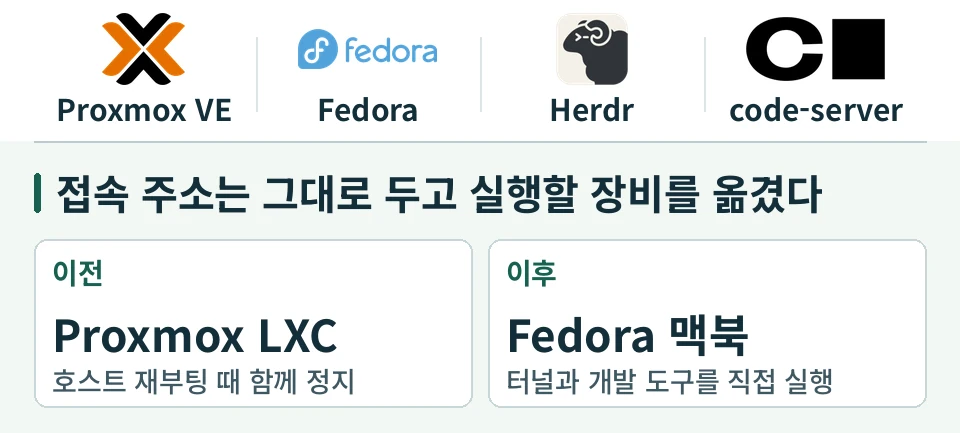

# 홈서버 재구성 ② | 개발서버 분리하기

**Herdr와 code-server가 멈췄다. 개발서버는 독립하기로 했다.**

Herdr와 code-server에 장애가 났다. 하나는 터미널 작업을 이어가던 곳이고, 다른 하나는 브라우저에서 코드를 열고 고치던 곳이다. 홈서버를 손봐야 하는데, 평소 그 일을 하던 작업대도 같은 서버 안에 있었다.

[1편](https://www.0plan.dev/blog/홈서버%20재구성/1.%20Proxmox에%20NAS%20VM%20만들기.md)에서는 파일을 어느 디스크에 보관할지 정리했다. 이번 질문은 조금 다르다. **그 디스크가 달린 서버를 꺼야 할 때, 나는 어디서 일할 수 있을까?** 두 서비스의 장애 원인이 같았는지는 이 질문에 답하는 데 중요하지 않았다. 다음 점검 때 쓸 작업대는 다른 장비에 두기로 했다.

## VM을 하나 더 만드는 대신 맥북을 꺼냈다



기존 개발환경은 Proxmox 안의 리눅스 컨테이너(LXC)였다. [Proxmox LXC에 code-server를 설치](https://www.0plan.dev/blog/홈서버%20구축/5.%20Proxmox에%20VSCode%20Server%20설치하여%20원격%20코딩%20환경%20구축하기.md)하면 노트북에서 브라우저만 열어도 그 안의 코드를 고칠 수 있다. 다만 같은 호스트에 개발용 VM을 하나 더 만들어도 Proxmox를 재부팅하는 순간에는 편집기도 같이 꺼진다.

마침 별도로 쓸 수 있는 인텔 맥북 프로가 있었다. i9-9980HK 8코어 16스레드에 메모리 64GB인 장비다. 여기에 설치된 Fedora를 새 개발서버로 삼았다. 이번 선택에서 맥북의 가장 중요한 사양은 CPU가 아니라 **Proxmox와 전원 버튼이 다르다**는 점이었다.

그런데 프로그램만 맥북으로 옮겨서는 절반만 분리된다. 브라우저에서 들어오는 길이 여전히 Proxmox를 지나면 맥북이 켜져 있어도 접속은 끊긴다. 그래서 Fedora가 접속 터널도 직접 연결하게 했다.

```text
이전: 브라우저 → 기존 로그인 → 홈서버 터널 → Proxmox의 개발 컨테이너
이후: 브라우저 → 기존 로그인 → Fedora 터널 → 맥북의 Herdr·code-server
```

주소와 로그인 방식은 그대로다. 달라진 것은 로그인 **다음**에 어느 장비로 가느냐다. 집 인터넷이나 외부 로그인 서비스까지 이중화한 것은 아니지만, 이제 개발 화면을 열기 위해 Proxmox가 켜져 있을 필요는 없다.

## 새로 clone하면 어제 하던 일이 남을까?

원격 저장소를 다시 받으면 마지막으로 푸시한 코드는 돌아온다. 하지만 내가 다음에 열고 싶은 것은 대개 그 이후의 작업이다. 아직 커밋하지 않은 수정, 별도 디렉터리에 펼쳐 둔 Git worktree, 로컬 DB의 테스트 데이터 같은 것들이다. 기존 컨테이너의 `/workspace` 하나만 훑어도 충분하지 않았다. 그 아래 붙어 있던 약 33GiB의 별도 마운트는 같은 파일 시스템만 집계한 작업공간 용량에서 통째로 빠져 있었다.

Fedora에서는 프로젝트를 사용자 홈의 `~/DEV` 아래에 놓았다. 1차 대조에서 Git 저장소 43개의 브랜치, 현재 커밋, 작업 트리 상태가 원본과 같았다. 여기서 *상태가 같다*는 말에는 한계가 있다. 양쪽 `git status`에 같은 파일이 ‘수정됨’으로 표시돼도 수정 내용이 한 글자까지 같다는 뜻은 아니다. 가상환경과 실행기도 따로 확인했다. 경로가 `/workspace`에서 바뀌면 소스는 멀쩡해도 예전 경로를 가리키는 실행기가 먼저 깨질 수 있어서다.

Herdr도 마찬가지였다. 작업 기록을 보존하는 것과 실행 중인 터미널 프로세스를 다른 컴퓨터로 옮기는 것은 다른 일이다. 기존 세션을 종료해서 자리를 비우는 대신, 원본을 살려 둔 채 Fedora 쪽에서 새로 접속하고 다시 연결할 수 있는지 시험했다.

## 로그인 화면이 뜨면 성공일까?

평소 쓰던 주소를 바로 바꾸지 않았다. Herdr와 code-server에 시험 주소를 하나씩 붙이고 Fedora 쪽으로 연결했다. 처음 눈에 보인 결과는 로그인 화면이었다. 반가운 화면이지만, 여기서 요청에 답한 것은 인증 서비스다. 이 시점에는 편집기에서 파일 하나 저장할 수 있을지조차 모른다.

그래서 전환 전후의 확인을 나눴다.

| 시점 | 확인한 것 | 알 수 있었던 것 |
|---|---|---|
| 시험 주소, 로그인 후 | 브라우저에서 터미널을 열고 재접속하고, 편집기에서 시험 파일을 열고 저장했다. | 새 장비에서 실제 작업을 할 수 있었다. |
| 기존 주소를 Fedora로 전환한 뒤 | 기존 로그인 경로와 TLS 인증서를 확인하고, 새 터널을 통한 두 서비스의 상태 요청에서 `200`을 받았다. | 익숙한 주소가 유지됐고 새 터널 뒤의 서비스가 응답했다. |
| 전환 후 실시간 연결 | 두 서비스의 WebSocket 연결에서 `101`을 확인하고, Herdr에서는 데이터 프레임도 받았다. | HTML 페이지만 열리는 것이 아니라 터미널에 필요한 실시간 연결도 성립했다. |

이 순서 덕분에 주소를 바꾸는 일과 원본을 지우는 일을 한 번에 결정할 필요가 없었다. 접속 대상을 Fedora로 전환한 뒤에도 기존 컨테이너의 서비스는 바로 끄지 않았다. 브라우저에서 편집기가 열린다고 해서 옛 작업 디렉터리의 마지막 변경분과 DB까지 전부 옮겨졌다는 뜻은 아니기 때문이다.

## 분리하고 나서 달라진 것

가장 큰 변화는 접속 주소를 새로 외웠다거나 빌드가 몇 초 빨라졌다는 게 아니다. 여전히 같은 주소에서 코드를 열지만, 이제 NAS의 디스크를 점검할 때 **개발 세션부터 어디로 피신시킬지** 고민하지 않아도 된다.

개발서버를 분리하면서 가장 쓸모 있었던 질문은 “파일을 다 복사했나?”보다 구체적이었다. **“원래 서버를 경유하지 않고도, 어제 쓰던 주소에서 파일 하나를 열고 고친 뒤 터미널에 다시 붙을 수 있나?”** 이번 이전의 완료 기준은 그 한 번의 작업이었다. 원본을 지워도 되는지는 별도의 질문으로 남겨 뒀다.

*[그림 출처 및 이용 조건](https://raw.githubusercontent.com/0plan/blog/483cbd2a01d481c65a92f36ec805558f8858debf/assets/images/article-figures/credits.txt)*

## 다음에 읽으면 좋은 글

[Oracle Cloud와 우리 집 홈서버는 어떻게 연결되어 있을까?](../%EC%98%A4%EB%9D%BC%ED%81%B4%20%ED%81%B4%EB%9D%BC%EC%9A%B0%EB%93%9C%28OCI%29/Oracle%20Cloud%EC%99%80%20%ED%99%88%EC%84%9C%EB%B2%84%EB%A5%BC%20%EC%97%B0%EA%B2%B0%ED%95%98%EB%8A%94%20%ED%84%B0%EB%84%90.md) — 맥북으로 서버를 옮겼는데도 브라우저에 입력하는 주소는 그대로였다. 그 주소로 들어온 요청이 Oracle Cloud를 거쳐 집 안의 터미널에 도착하기까지를 따라간다.

Oracle Cloud가 낯설다면 [OCI 개요](https://www.0plan.dev/blog/오라클%20클라우드%28OCI%29/OCI%20개요.md)부터 읽어도 좋다.
