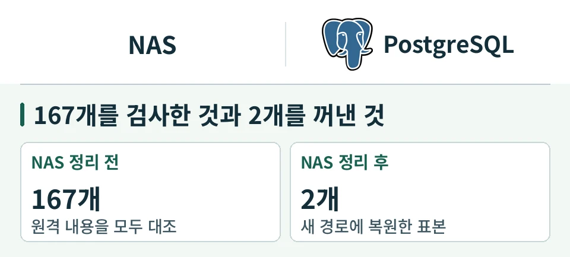

# NAS의 30일 지난 백업, 언제 지워도 될까?

NAS에 DB 덤프를 쌓아 두면 최근 백업을 꺼내기 편하다. 문제는 ‘최근’을 한 달로 정한 다음이다. 31일째 되는 날 파일을 지우려는데, 외부 저장소에는 같은 이름의 파일이 보인다. 그것으로 충분할까?

우리 집에서는 **30일은 삭제 기준이 아니라 이관 후보를 고르는 기준**으로 정했다. 최근 사본은 NAS에 두고, 오래된 일반 백업은 외부에 보관한다. NAS의 파일을 지우는 것은 원격 사본의 내용을 다시 읽고 난 뒤의 별도 단계다.

167개 중 2개만 검사했다는 뜻이 아니다. 두 숫자를 가르는 지점은 **로컬 사본이 아직 있었나, 이미 정리됐나**다.

## 같은 31일짜리 파일도 하나는 남는다

Oracle과 Proxmox에서 모은 정기 백업 중 날짜를 식별할 수 있는 DB·게임·현역 VM 백업을 대상으로 삼았다. 파일명에 들어 있는 백업 날짜와 파일의 마지막 수정 시각이 **둘 다** 30일을 넘어야 한다. 9월 백업이라는 이름을 달고 있어도 어제 내용이 다시 쓰였다면 대상이 아니다.

날짜 조건을 통과해도 같은 종류의 **가장 최신 백업**은 남긴다. 백업 생성이 한 달 넘게 멈췄을 때, 마지막으로 성공한 파일까지 ‘오래됐다’는 이유로 정리하면 곤란하기 때문이다. 보호 표시가 있는 파일과 다른 경로에서도 참조하는 하드링크 파일 등도 이 정책에서 제외했다.

## 업로드와 삭제 사이에 넣은 두 번의 확인

1. **원격에서 다시 읽는다.** 이관 전 NAS 파일의 상대 경로·크기·SHA-256을 기록한다. 업로드가 끝나면 방금 만든 스냅숏에서 **대상 파일 전부**를 다시 읽는다. 파일마다 바이트 수와 해시가 맞는지, 빠진 파일이나 뜻밖의 파일이 없는지 확인한다. 모두 통과한 뒤 어느 저장소의 어느 스냅숏에서 무엇을 복원할 수 있는지 기록을 남긴다.
2. **NAS에서 다시 고른다.** 검증에 시간이 걸리는 동안 같은 경로에 새 덤프가 들어올 수 있다. 원격에서 확인한 것은 조금 전 파일이지, 지금 그 이름으로 놓인 파일이 아니다. 삭제 직전에 수집 작업과 겹치지 않게 잠금을 잡고 후보를 다시 계산한다. 파일 식별 정보·크기·변경 시각 등이 처음과 일치하는 사본만 지운다.

첫 확인은 **“되찾을 수 있나?”**, 두 번째는 **“지금 치우려는 것이 되찾을 수 있다고 확인한 바로 그 파일인가?”**에 답한다. 원격 해시가 맞아도 두 번째 질문의 답은 달라질 수 있다.

## 첫 이관: 167개를 검증하고, 정리 후 2개를 다시 꺼냈다

2026년 11월 26일 첫 이관 대상은 한 서비스의 정기 백업 **167개, 총 275,365,643바이트**였다. 167개 모두를 원격에서 다시 읽어 확인했다. 그리고 11:07, 해당 파일들이 NAS 수집 경로에서 제거된 뒤 **PostgreSQL 덤프 한 개와 아카이브 한 개**를 새 경로에 실제 파일로 복원했다. 둘 다 기록해 둔 해시와 일치했고 파일 형식도 확인했다.

이 두 숫자는 다른 질문의 답이다. **167개**는 로컬 사본을 정리하기 전에 원격 내용을 읽어 원본과 대조한 개수다. **2개**는 정리한 뒤 복원 기록을 따라가 실제 파일로 다시 꺼낸 표본이다. 덤프를 새 DB에 넣고 애플리케이션까지 띄운 시험은 아니다.

정책을 만들고 나니 ‘30일 뒤에 백업을 지운다’는 설명은 맞지 않았다. **30일 뒤부터 어디에 보관할지 검토하고, 나중에 복원할 위치와 해시를 남긴 다음, 확인된 로컬 사본만 정리한다.** 나중에 파일 하나를 되찾아야 할 때 필요한 것도 보관 기간이라는 숫자보다 그 기록이다.

*[그림 출처 및 이용 조건](https://raw.githubusercontent.com/0plan/blog/483cbd2a01d481c65a92f36ec805558f8858debf/assets/images/article-figures/credits.txt)*

## 다음에 읽으면 좋은 글

- [restic 스냅숏은 생겼는데 파일은 안 읽혔다: 321개 파일 복원기](restic%20%EC%8A%A4%EB%83%85%EC%88%8F%EC%97%90%EC%84%9C%20%ED%8C%8C%EC%9D%BC%20321%EA%B0%9C%20%EB%B3%B5%EC%9B%90%ED%95%98%EA%B8%B0.md) — 이름과 스냅숏이 존재해도 내용을 다시 읽는 절차가 필요한 이유를 실제 복원 사례로 볼 수 있다.
