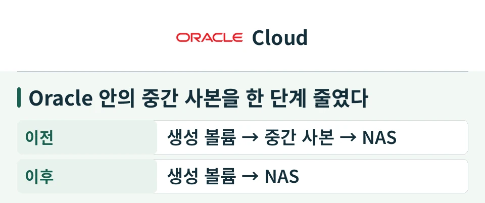

# NAS에 백업하려는데 왜 Oracle 디스크에 같은 파일이 두 벌 필요할까?

Oracle에서 만든 DB 덤프는 이미 백업용 볼륨에 있었다. 목적지는 집의 NAS였다. 그런데 예전 전송 작업은 볼륨에서 파일을 읽어 **같은 Oracle 서버의 별도 백업 디렉터리에 한 번 더 복사한 뒤**, 그 디렉터리에서 NAS로 보냈다. 파일 하나를 기준으로 그리면 불필요한 경유지가 보인다.

중간 사본에도 쓸모가 없었던 것은 아니다. 백업을 만든 프로세스와 NAS로 보내는 사용자의 파일 접근 권한이 달랐다. 하지만 같은 디스크에 데이터를 두 벌 두는 것만이 권한을 나누는 방법은 아니었다. 같은 서버가 고장 나면 두 벌을 한꺼번에 잃는다는 점도 같았다.

## 읽을 수 있는 사람과 보낼 수 있는 곳을 분리했다

11월 25일 변경에서는 생성 볼륨을 읽을 때 필요한 로컬 권한을 쓰되, NAS로 보내는 연결은 기존 전송 사용자로 열었다. 수신 쪽에서는 해당 백업 디렉터리에만 쓰도록 한 제한을 유지했다. 덕분에 전송을 위해 Oracle에 두 번째 사본을 만들 필요가 없어졌다. 이 변경으로 확보한 용량을 별도로 실측한 기록은 없어, 다른 디스크 정리 작업의 회수량과 합산하지 않았다.

중간 단계를 없앨 때 한 가지 더 봤다. **지금도 파일이 생기는 디렉터리와 이미 동결한 보존본은 같은 규칙으로 골라도 되는가?** 운영 중인 수집 경로에서는 `.partial`이나 `.tmp`가 아직 쓰는 중인 파일일 수 있다. 반면 퇴역 시점에 통째로 보존하기로 한 경로에는 `.tmp`까지 당시 상태를 보여 주는 자료였다. 살아 있는 수집 경로에 쓰던 제외 패턴을 보존본에도 적용하면, 전송은 성공해도 남기기로 한 파일이 빠진다.

백업 경로를 줄인 뒤에도 지켜야 할 약속은 같았다. **완성된 파일을 약속한 곳에 전달하고, 원본에서 지운 파일을 NAS에서도 따라 지우지 않는 것.** 경로를 한 칸 줄이되 사본을 둔 목적과 전송 권한까지 한꺼번에 없애지는 않았다.

*[그림 출처 및 이용 조건](https://raw.githubusercontent.com/0plan/blog/483cbd2a01d481c65a92f36ec805558f8858debf/assets/images/article-figures/credits.txt)*

## 다음에 읽으면 좋은 글

[백업은 두 번째 실행에서 왜 완료 시각을 갱신하지 못했을까?](Proxmox%20%EB%B0%B1%EC%97%85%EC%9D%98%20%EB%91%90%20%EB%B2%88%EC%A7%B8%20%EC%99%84%EB%A3%8C%20%EA%B8%B0%EB%A1%9D.md) — 파일을 옮기는 단계와 ‘전송이 끝났다’고 다음 작업에 알려 주는 단계는 따로 실패할 수 있다.
