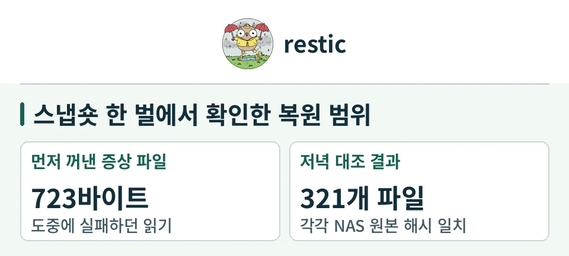
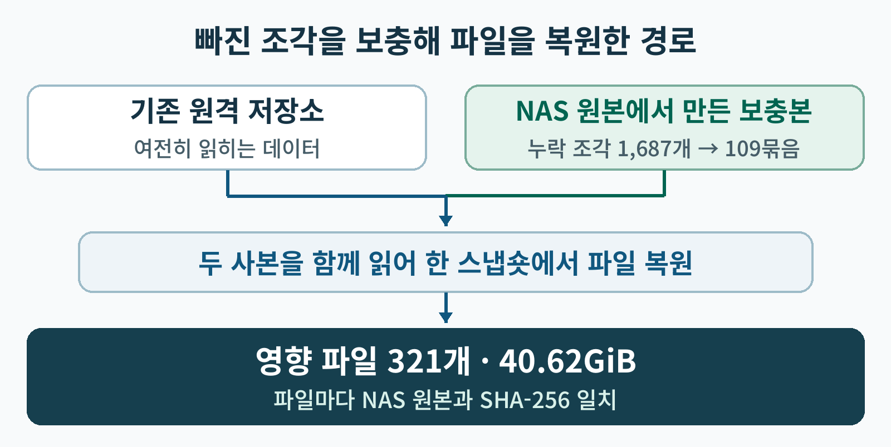

# restic 스냅숏은 생겼는데 파일은 안 읽혔다: 321개 파일 복원기

2026년 11월 26일 아침, 과거 Proxmox 자료 약 285GiB를 담은 restic 스냅숏이 원격 저장소 목록에 올라와 있었다. 그런데 07:36, 후속 검증에 실패했다. 저장소에 데이터 파일 108개와 색인 파일 한 개의 **이름은 보였지만**, 그 내용을 읽는 데 필요한 정보가 없었다. 목록 화면만 봤다면 보지 못했을 고장이었다.

그날 저녁 확인한 결과부터 말하면, 문제의 스냅숏에서 누락된 조각을 사용하던 **파일 321개를 모두 복원해 원본과 대조했다.** 여기서 321개가 무엇의 개수인지가 중요하다.

작은 파일 하나가 돌아온 건 **같은 실패를 다시 통과했다**는 증거였다. 다른 파일의 복원까지 말하려면 오른쪽 검사가 따로 필요했다.

## 저장소 파일 109개가 원본 파일 109개를 뜻하지 않는다

restic은 원본 파일을 조각으로 나눠 보관한다. 같은 내용의 조각은 여러 파일이나 스냅숏이 함께 가리킬 수 있고, 실제 저장소에서는 여러 조각이 한 묶음에 들어간다. 스냅숏에서 파일 이름을 찾는 것과, 그 파일을 구성하는 조각을 빠짐없이 읽는 것은 서로 다른 일이다.

다행히 원격 백업을 만들었다고 Proxmox와 NAS의 원본을 지우지 않았다. NAS 쪽 파일에서 누락된 조각 **1,687개**를 찾아 각각의 SHA-256을 대조할 수 있었다. 이 조각들로 암호화된 **보충 묶음 109개(1.78GiB)**를 만들었다. 기존 원격 저장소를 멀쩡한 새 저장소로 교체한 것은 아니다. 복원할 때 **기존 저장소에서 읽히는 부분과 보충본을 함께** 사용했다. 따라서 보충본만 따로 남겨도 안 된다.

## 723바이트 파일 하나를 먼저 꺼낸 이유

11:51에는 보충 파일을 전부 다시 읽어 대조하고, 두 사본을 함께 보는 복원 경로에서 기존 스냅숏 12개에 대해 `restic check`를 통과했다. 다음으로 **전에 읽히지 않았던 723바이트짜리 파일**을 골랐다. 이미 잘 읽히던 큰 파일 하나보다, 실패했던 그 작은 파일이 이번 조치가 맞았는지 알려 주는 데 더 유용했다. 복원 파일의 SHA-256은 NAS 원본과 같았다.

그래도 이 시점의 결론은 ‘문제 파일 하나를 다시 읽었다’였다. 기본 `restic check`는 색인과 데이터 참조의 일관성을 검사하지만 저장소 전체의 데이터 바이트를 전부 읽지는 않는다. 반대로 증상 파일 하나가 돌아왔다고 해서 같은 조각을 쓰는 다른 파일까지 돌아온 것도 아니다.

## 마지막 기준은 파일 수와 내용이었다

저녁에는 스냅숏 하나로 범위를 정하고, 누락 조각을 참조하던 옛 미러의 파일들을 별도 복원 디렉터리에 꺼냈다. 19:01의 결과는 다음과 같다.

| 확인한 것 | 결과 |
|---|---|
| 이 스냅숏에서 누락 조각을 참조하던 파일 | 321개 |
| 그 파일들을 복원한 크기 | 43,610,758,577바이트(40.62GiB) |
| 복원 검증과 NAS 원본 대조 | 321개 모두 `restic restore --verify` 통과, 파일별 SHA-256 일치 |

1.78GiB를 보충해 40.62GiB를 꺼낼 수 있었던 건 파일의 나머지 조각들이 기존 저장소에 있었기 때문이다. 이 결과를 **‘285GiB 전체 복원 성공’**이라고 적으면 다음 복구 때 잘못된 약속을 하게 된다. 내가 남긴 결론은 더 좁다. **이 스냅숏에서 영향을 받은 321개는, 기존 저장소와 보충본을 함께 쓰면 원본과 같은 파일로 복원된다.** 기본 저장소 하나만 쓰던 백업 작업까지 정상화됐다는 뜻도 아니다.

*[그림 출처 및 이용 조건](https://raw.githubusercontent.com/0plan/blog/483cbd2a01d481c65a92f36ec805558f8858debf/assets/images/article-figures/credits.txt)*

## 다음에 읽으면 좋은 글

- [NAS의 30일 지난 백업, 언제 지워도 될까?](NAS%EC%9D%98%2030%EC%9D%BC%20%EC%A7%80%EB%82%9C%20%EB%B0%B1%EC%97%85%EC%9D%84%20%EC%A7%80%EC%9A%B0%EB%8A%94%20%EA%B8%B0%EC%A4%80.md) — 이번 복구의 출발점은 아직 NAS에 원본이 있었다는 사실이다. 그렇다면 어떤 증거가 생긴 뒤에야 로컬 사본을 지울 수 있을까?
