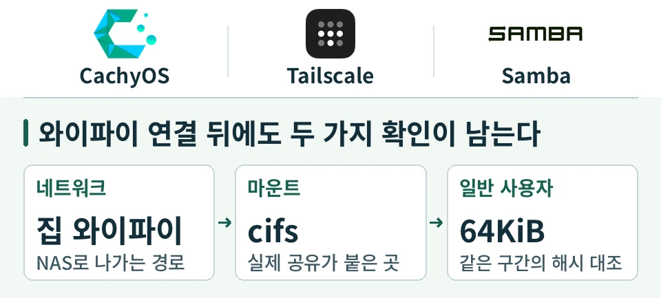

# 와이파이는 돌아왔는데, NAS 폴더는 왜 비어 있었을까?

2026년 11월 26일 새벽 01:14, 집 데스크톱에서 평소 열던 NAS 폴더가 비어 보였다. 직전에 와이파이가 끊겼다 다시 연결됐다. 이런 화면을 보면 먼저 NAS 디스크가 걱정된다. 그런데 **폴더가 열린다는 사실만으로는 그 폴더가 지금 NAS를 보여 주고 있는지도 알 수 없다.**

와이파이 아이콘이 켜졌을 때 증명된 건 첫 단계의 일부뿐이다. 마지막 단계는 평소 쓰는 계정으로 **NAS에 있던 바이트를 읽어야** 통과한다.

## 같은 데스크톱인데 NAS에서는 다른 곳에서 온 요청이었다

데스크톱은 CachyOS에서 SMB를 사용해 NAS의 공유 폴더를 마운트한다. 이 공유에는 집 와이파이에 연결된 데스크톱 주소만 허용해 뒀다. 그날은 와이파이가 재연결되는 동안 SMB 요청이 평소의 무선 LAN 경로가 아니라 Tailscale의 서브넷 라우터를 거쳤다. NAS가 본 출발지 주소도 달라졌고, 연결은 거절됐다.

접속 권한을 풀면 당장 붙을 수도 있다. 하지만 “집 와이파이에서만 이 공유를 연다”는 설정이 잘못 작동한 것은 아니었다. 오히려 **다른 경로에서 들어온 요청을 의도대로 거절했다**는 로그가, 데스크톱에서 어느 경로를 다시 확인해야 하는지 알려 줬다.

## 네트워크가 회복돼도 마운트 실패 상태는 남는다

그 사이 데스크톱의 자동 마운트는 여러 번 실패해 systemd의 시작 재시도 한도(`mount-start-limit-hit`)에 걸렸다. 이후 와이파이 경로가 정상으로 돌아와도 마운트가 저절로 다시 성공한 것은 아니었다. 로컬에는 마운트 지점으로 쓸 디렉터리가 남아 있었다. 파일 관리자에서 본 빈 화면만으로는 NAS에서 파일이 지워졌다고 결론 내릴 수 없었던 이유다.

확인할 때는 질문을 나누는 게 도움이 됐다.

| 질문 | 데스크톱에서 볼 것 |
|---|---|
| 지금 NAS로 나가는 길이 맞나? | `ip route get`에 NAS 주소를 넣어 나가는 인터페이스와 출발지 주소를 본다. 와이파이 아이콘은 목적지별 경로까지 알려 주지 않는다. |
| 그 경로에 실제 공유가 붙었나? | `findmnt`에서 해당 마운트 지점에 `cifs` 파일시스템이 올라왔는지 본다. 폴더 이름이나 자동 마운트 대기 상태만 보는 것과 다르다. |
| 평소 쓰는 계정으로 내용도 읽히나? | 관리자 대신 데스크톱 일반 사용자로 NAS 파일을 실제로 읽는다. |

조치는 데스크톱 쪽에 뒀다. NetworkManager가 연결 변화를 알렸을 때 **NAS로 가는 집 와이파이 경로가 돌아온 경우에만** 실패한 자동 마운트를 다시 활성화한다. 단순히 ‘어떤 네트워크든 연결됨’을 신호로 삼으면 처음과 같은 경로에서 다시 실패할 수 있기 때문이다.

## 01:28, 폴더 목록 대신 파일 64KiB를 읽었다

복구 확인에는 내용이 있는 실제 파일 하나를 썼다. CachyOS 일반 사용자로 공유를 통해 파일 앞부분 **64KiB(65,536바이트)**를 읽고, NAS 쪽 같은 파일의 같은 구간에서 계산한 SHA-256과 비교했다. 해시가 일치했고 연결에 SMB 3.1.1 암호화가 적용된 것도 확인했다.

이 검사는 파일 전체나 NAS 디스크 전체가 정상이라는 증거는 아니다. 그날 확인하려던 질문은 더 작았다. **“내가 평소 쓰는 계정과 경로에서 NAS의 실제 바이트를 다시 읽을 수 있는가?”** 01:28에는 그 답을 ‘예’라고 기록할 수 있었다.

*[그림 출처 및 이용 조건](https://raw.githubusercontent.com/0plan/blog/483cbd2a01d481c65a92f36ec805558f8858debf/assets/images/article-figures/credits.txt)*

## 다음에 읽으면 좋은 글

- [홈서버 재구성 ① | Proxmox에 NAS VM 만들기](https://www.0plan.dev/blog/홈서버%20재구성/1.%20Proxmox에%20NAS%20VM%20만들기.md) — 이번에는 데스크톱 쪽 마운트가 빠졌다. NAS VM 안에서도 데이터 디스크 없이 빈 디렉터리를 공유하는 일을 어떻게 막았는지 이어서 볼 수 있다.
