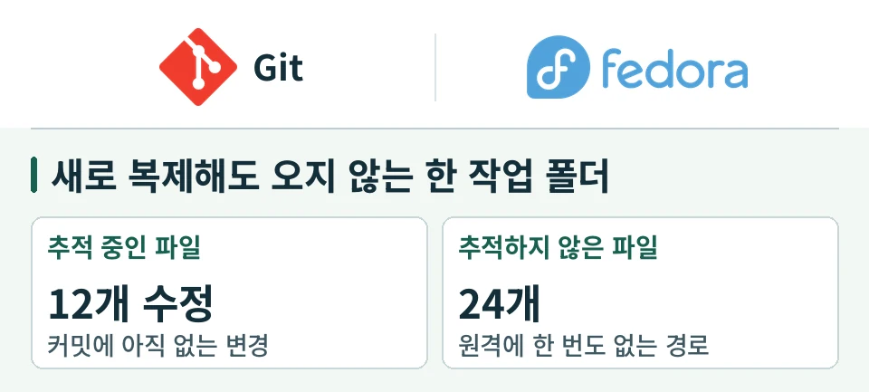

# 개발서버를 옮길 때 `git clone`으로 돌아오지 않는 것들

Fedora로 개발환경을 옮기기 전, 원본에 남은 Git 작업 폴더 하나가 눈에 띄었다. 브랜치에 붙어 있지 않은 `detached HEAD`였고, 추적 중인 파일 12개가 수정돼 있었으며 추적하지 않는 파일이 24개 더 있었다. 원격 저장소를 새로 복제하면 커밋은 받을 수 있다. 이 폴더에서 **아직 커밋하지 않은 작업**은 따라오지 않는다.

24개는 새 저장소에서 `git status`를 실행해도 찾을 수 없다. **복사하기 전에 원본 폴더에서 세야 하는 숫자**다.

## 프로젝트 목록과 작업 중인 폴더 목록이 달랐다

하나의 Git 저장소에도 여러 작업 디렉터리, 즉 *worktree*를 둘 수 있다. 별도 브랜치를 다른 폴더에 펼쳐 놓고 동시에 일할 때 편하다. 문제는 이관 기준을 ‘프로젝트가 모인 디렉터리의 하위 폴더’로 잡았을 때다. 실제 조사에서는 개발 도구가 사용자 홈 아래 별도 위치에 만든 worktree들도 나왔다.

여기에 함정이 하나 더 있다. 연결된 worktree의 `.git`은 디렉터리가 아니라 **실제 Git 메타데이터의 위치를 적은 파일**일 수 있다. 조사 중 원본에서부터 다른 호스트의 절대경로를 가리켜 Git이 읽지 못하는 항목도 발견했다. 목적지에서 열리지 않는다고 모두 이번 복사의 실수인 것은 아니었다. 원래부터 깨진 연결과 새로 깨진 연결을 구분하려면, 복사 전에 원본 상태부터 기록해야 한다.

## 복사 전후에 비교한 질문

| 보고 싶은 것 | 확인 방법 |
|---|---|
| 내가 아는 본체 외에 등록된 작업 폴더가 있는가? | 원본 저장소에서 `git worktree list --porcelain`을 보고, 실제 디스크에 남은 폴더와 대조한다. |
| 같은 커밋에서 이어지는가? | 각 폴더의 `HEAD`와 브랜치 상태를 비교한다. 브랜치가 없는 상태도 그대로 기록한다. |
| 커밋 밖에 무엇이 남았는가? | `git status --short`로 수정·추가·미추적 경로를 확인한다. 무시된 파일이나 로컬 DB까지 이 명령이 챙겨 주지는 않는다. |

이관 중간 점검에서 유효한 저장소 43개의 `HEAD`·브랜치·상태가 원본과 일치했다. 이것은 좋은 출발점이지 파일 내용 전체의 검증은 아니다. 양쪽에 똑같이 `M config.py`가 찍혀도 수정한 바이트가 같다는 뜻은 아니기 때문이다. 중요한 미커밋 파일은 실제 내용까지 비교해야 지워도 되는 사본을 가릴 수 있다.

다시 옮긴다면 ‘저장소가 몇 개인가?’보다 **‘내일 아침 어느 폴더에서 무슨 작업을 이어야 하나?’**를 먼저 묻겠다. 그래야 원격에는 존재한 적조차 없는 24개 파일이 이관 목록에 들어간다.

*[그림 출처 및 이용 조건](https://raw.githubusercontent.com/0plan/blog/483cbd2a01d481c65a92f36ec805558f8858debf/assets/images/article-figures/credits.txt)*

## 다음에 읽으면 좋은 글

[홈서버 재구성 ②: 개발서버 분리하기](2.%20%EA%B0%9C%EB%B0%9C%EC%84%9C%EB%B2%84%20%EB%B6%84%EB%A6%AC%ED%95%98%EA%B8%B0.md) — 파일을 옮긴 뒤 터미널 재접속과 편집기 저장까지 어디에서 확인했는지 다뤘다.
