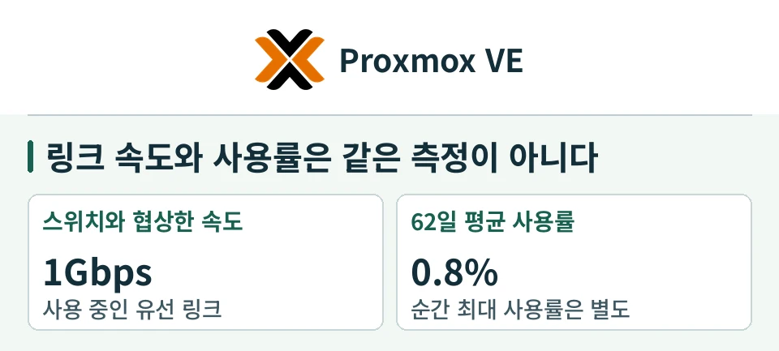

# 홈서버의 두 번째 랜 포트를 비워 둔 이유

홈서버 뒤에는 랜 포트가 두 개 있다. 하나만 연결해 둔 모습을 보면 남는 쪽까지 스위치에 꽂고 싶어진다. NAS 파일 전송도 하고 여러 VM도 돌리니, 선이 두 가닥이면 나을 것 같았다. 케이블을 추가하기 전에 지금 쓰는 한 가닥에서 무엇이 부족한지 숫자 세 개를 봤다.

왼쪽은 **얼마까지 보낼 수 있게 연결됐는지**, 오른쪽은 **오랫동안 그 용량을 얼마나 썼는지**다. 아래 표의 SSH 전송값은 또 다른 경로에서 잰 수치다.

| 측정한 대상 | 값 | 이 숫자가 말해 주는 것 |
|---|---:|---|
| 사용 중인 유선 링크 | 1Gbps | 홈서버와 스위치 사이에서 협상된 링크 속도 |
| 집 회선 SSH 전송 실측 | 업로드 497Mbps / 다운로드 634Mbps | 9월 10일 그 경로에서 실제로 낸 전송 속도 |
| 유선 인터페이스 62일 평균 사용률 | 0.8% | 관측 기간 전체로 보면 링크를 계속 채우고 있지는 않았다는 것 |

이 셋은 서로 대체할 수 없다. 인터넷 경로의 SSH 전송 결과가 집 안에서 NAS 파일을 읽는 속도는 아니다. 62일 평균이 낮아도 일요일 백업 시간의 10분은 바빴을 수 있다. 다만 **평소 링크가 포화돼 있으니 하나 더 꽂자**는 설명을 지지할 숫자는 아니었다.

## 포트 두 개와 2Gbps 연결 하나는 다르다

같은 서브넷에 인터페이스를 두 개 붙였다고 운영체제와 스위치가 자동으로 한 연결처럼 쓰지는 않는다. 어느 인터페이스를 통해 응답하는지가 복잡해질 수 있고, 파일 복사 한 건이 저절로 두 링크에 걸쳐 흐르지도 않는다. 링크 집성으로 여러 흐름을 나누는 것, 네트워크를 용도별로 분리하는 것, 선이 끊겼을 때 다른 선으로 넘기는 것도 각각 목적이 다른 구성이다.

그래서 두 번째 포트는 연결하지 않은 상태로 뒀다. 언젠가 백업 시간에 실제로 불편해지면, 평균을 다시 계산하기보다 **느렸던 바로 그 시간**에 송수신량과 디스크 읽기·쓰기를 함께 보겠다. 디스크에서 데이터를 충분히 못 내주는데 랜 포트만 늘려서는 전송이 빨라지지 않는다. 남는 포트를 쓰는 것보다, 다음 측정에서 무엇이 병목이면 구성을 바꿀지 정해 두는 편이 이 서버에는 맞았다.

*[그림 출처 및 이용 조건](https://raw.githubusercontent.com/0plan/blog/483cbd2a01d481c65a92f36ec805558f8858debf/assets/images/article-figures/credits.txt)*

## 다음에 읽으면 좋은 글

[와이파이는 돌아왔는데, NAS 폴더는 왜 비어 있었을까?](NAS%EC%99%80%20%EB%B0%B1%EC%97%85/%EC%99%80%EC%9D%B4%ED%8C%8C%EC%9D%B4%20%EB%B3%B5%EA%B5%AC%20%ED%9B%84%20SMB%20%EA%B3%B5%EC%9C%A0%20%ED%99%95%EC%9D%B8%ED%95%98%EA%B8%B0.md) — 실제 접속 장애에서는 대역폭이 아니라 요청이 어느 경로로 들어왔는지가 원인이었다.
